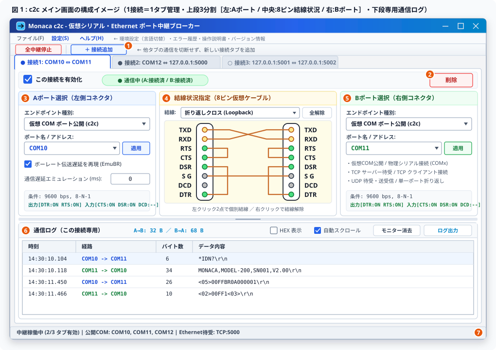
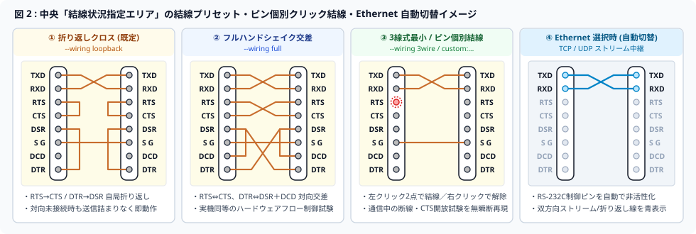
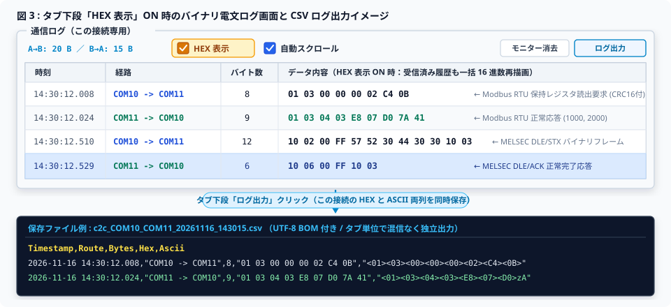
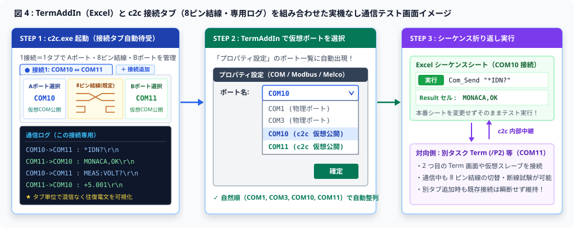
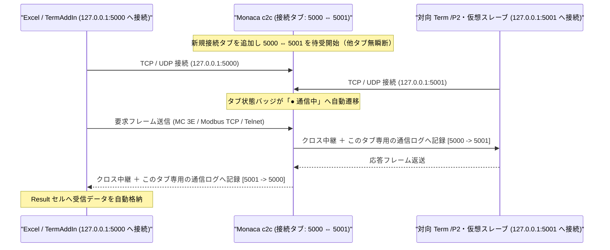

# c2c 操作説明書 (User Operation Manual)

👉 [← c2c 製品トップに戻る](../README.md)  
👉 [← TermAddIn 統合本体に戻る](https://github.com/Monaca-App/TermAddIn)

---

本ドキュメントは、カーネルドライバや管理者権限を一切必要とせず、Windows 標準ユーザー環境で **仮想 COM ポート同士のヌルモデム（8ピン仮想ケーブル）接続** 、 **Ethernet（TCP / UDP）ポートの模擬・プロキシ中継・単一ポート折り返し** 、 **物理シリアル中継（スニファ・2ポート間クロス）** 、および **接続タブ単位のリアルタイム通信ログ監視** を実現する **「Monaca c2c」** の操作説明書です。

---

# 目次

- [📖 1. 概要と基本動作](#-1-概要と基本動作)
  - [1.1 本ツールの役割と 4 つの利用シーン](#11-本ツールの役割と-4-つの利用シーン)
  - [1.2 起動方法と終了時の自動クリーンアップ](#12-起動方法と終了時の自動クリーンアップ)
  - [1.3 はじめて使う方向け・基本用語と RS-232C 信号線の解説](#13-はじめて使う方向け基本用語と-rs-232c-信号線の解説)
- [🖥️ 2. メイン画面の構成（1接続＝1タブ管理）と各部の機能](#️-2-メイン画面の構成1接続1タブ管理と各部の機能)
  - [2.1 メイン画面全体イメージ](#21-メイン画面全体イメージ)
  - [2.2 ① 上部メニューバー・ツールバーと接続タブバー（非破壊追加）](#22--上部メニューバーツールバーと接続タブバー非破壊追加)
  - [2.3 ② タブ内ヘッダバー（有効化スイッチ・状態バッジ・「削除」ボタン）](#23--タブ内ヘッダバー有効化スイッチ状態バッジ削除ボタン)
  - [2.4 ③〜⑤ 上半分・三分割構成エリア（Aポート選択 ／ 8ピン結線状況指定 ／ Bポート選択）](#24--上半分三分割構成エリアaポート選択--8ピン結線状況指定--bポート選択)
  - [2.5 ⑥ 下半分・専用通信ログエリアと ⑦ 下部ステータスバー](#25--下半分専用通信ログエリアと--下部ステータスバー)
- [🔀 3. ポート組み合わせモードと 8 ピン結線状況の指定方法](#-3-ポート組み合わせモードと-8-ピン結線状況の指定方法)
  - [3.1 Aポート・Bポートの選択組み合わせ（全 12 モード）](#31-aポートbポートの選択組み合わせ全-12-モード)
  - [3.2 中央「結線状況指定エリア」のプリセット切替とピン個別クリック操作](#32-中央結線状況指定エリアのプリセット切替とピン個別クリック操作)
  - [3.3 通信エミュレーション設定（ボーレート遅延 EmuBR・通信遅延 ms）](#33-通信エミュレーション設定ボーレート遅延-emubr通信遅延-ms)
  - [3.4 入力チェック・電気的短絡防止メッセージと対処方法](#34-入力チェック電気的短絡防止メッセージと対処方法)
- [🔍 4. 接続タブ専用通信ログの活用と CSV / テキスト保存](#-4-接続タブ専用通信ログの活用と-csv--テキスト保存)
  - [4.1 ASCII 表示モードと制御コードの可視化ルール](#41-ascii-表示モードと制御コードの可視化ルール)
  - [4.2 HEX 表示モードへの切り替え（バイナリ電文解析）](#42-hex-表示モードへの切り替えバイナリ電文解析)
  - [4.3 タブ単位での CSV / テキストログ保存](#43-タブ単位での-csv--テキストログ保存)
- [🚀 5. 実践ガイド：TermAddIn / Term と連携した通信テスト手順](#-5-実践ガイドtermaddin--term-と連携した通信テスト手順)
  - [5.1 シナリオ A：仮想 COM ペアと 8 ピン結線切替でシリアル通信を実機なしテストする](#51-シナリオ-a仮想-com-ペアと-8-ピン結線切替でシリアル通信を実機なしテストする)
  - [5.2 シナリオ B：Ethernet 2 ポート間クロス中継・折り返しで TCP / UDP 通信をテストする](#52-シナリオ-bethernet-2-ポート間クロス中継折り返しで-tcp--udp-通信をテストする)
  - [5.3 シナリオ C：実機（物理 COM または LAN 上の PLC・計測器）の通信を傍受・モニターする](#53-シナリオ-c実機物理-com-または-lan-上の-plc計測器の通信を傍受モニターする)
  - [5.4 シナリオ D：仮想 COM ポートと外部 TCP / UDP 機器シミュレータを相互変換する](#54-シナリオ-d仮想-com-ポートと外部-tcp--udp-機器シミュレータを相互変換する)
- [⌨️ 6. コマンドライン（CLI）モードの操作リファレンス](#️-6-コマンドラインcliモードの操作リファレンス)
  - [6.1 CLI サブコマンド・結線指定オプション一覧](#61-cli-サブコマンド結線指定オプション一覧)
  - [6.2 バッチ・自動テストスクリプトからの活用例](#62-バッチ自動テストスクリプトからの活用例)
- [⚙️ 7. 設定ファイルの管理とトラブルシューティング（FAQ）](#️-7-設定ファイルの管理とトラブルシューティングfaq)
  - [7.1 設定ファイル・稼働管理ファイル・監査ログの保存場所](#71-設定ファイル稼働管理ファイル監査ログの保存場所)
  - [7.2 よくある質問と対処方法（FAQ）](#72-よくある質問と対処方法faq)

---

## 📖 1. 概要と基本動作

### 1.1 本ツールの役割と 4 つの利用シーン
**Monaca c2c** は、実機の計測器・PLC・組込基板や RS-232C クロスケーブル・LAN 環境が手元にない場面でも、PC 1 台だけでシリアル通信（8 ピン信号線レベル）と Ethernet（TCP / UDP）通信の双方を自在に模擬・監視できる公式コンパニオンツールです。カーネルドライバの導入や OS 再起動を必要とせず、以下の 4 つの場面でそのまま活用できます。

1. **実機なしの PC 内シリアル通信 ＆ ハードウェア制御線・断線テスト（仮想 COM ペア）**:
   仮想ポート同士（例: `COM10` ⇔ `COM11`）を 8 ピン仮想ケーブル（`TXD, RXD, RTS, CTS, DSR, SG, DCD, DTR`）で直結し、片側に Excel アドイン **[TermAddIn](https://github.com/Monaca-App/TermAddIn)** （[COM シリアル通信](https://github.com/Monaca-App/TermAddIn_Comm) / [Modbus RTU・ASCII](https://github.com/Monaca-App/TermAddIn_Modbus) / [MELSEC 計算機リンク](https://github.com/Monaca-App/TermAddIn_Melco) / [オムロン HostLink](https://github.com/Monaca-App/TermAddIn_Omron) / [キーエンス KV 上位リンク](https://github.com/Monaca-App/TermAddIn_Keyence)）、もう片側に別タスクの **Term** や **[TermEmulator](https://github.com/Monaca-App/TermEmulator)** の仮想スレーブを接続して、折り返しクロス・フルハンドシェイク・片線断線まで事前検証できます。
2. **実機なしの PC 内 Ethernet（TCP / UDP）通信テスト（クロス中継・単一ポート折り返し）**:
   2 つのローカル待受ポート（例: `127.0.0.1:5000` ⇔ `127.0.0.1:5001`）を内部クロス中継し、 **[Telnet / ソケット通信](https://github.com/Monaca-App/TermAddIn_Telnet)** ・ **[Modbus TCP](https://github.com/Monaca-App/TermAddIn_Modbus)** ・ **[MELSEC MC プロトコル](https://github.com/Monaca-App/TermAddIn_MelcoMC)** ・ **[オムロン FINS](https://github.com/Monaca-App/TermAddIn_Omron)** ・ **[キーエンス KV 上位リンク](https://github.com/Monaca-App/TermAddIn_Keyence)** などのクライアントと対向スレーブを接続させたり、1 つのポート単独でエコー折り返し（`Loopback`）させたりできます。
3. **実機通信の電文傍受・エビデンス採取（物理シリアル中継 ／ Ethernet 外部プロキシ中継）**:
   通信アプリと実機（物理 `COM3` や LAN 上の PLC `192.168.1.10:5000` 等）の間に **c2c** を透過挿入することで、実機との間でやり取りされる全パケット（ASCII / HEX）をミリ秒精度で可視化・CSV 保存できます。
4. **シリアルとネットワークの相互変換ブリッジ（COM ⇔ TCP / UDP ブリッジ）**:
   TCP / UDP ソケット通信を行う外部シミュレータや Ethernet-シリアル変換器を仮想 COM ポートへ変換し、シリアル専用シーケンスからそのまま制御できます。

### 1.2 起動方法と終了時の自動クリーンアップ
* **GUI モード起動**: フォルダ内の **`c2c.exe`** をダブルクリック（引数なしで実行）すると、メイン画面が開き、有効化されているすべての接続タブの中継が **自動的に開始** されます。
* **初回起動時の初期接続タブ**: 設定ファイルがまだ存在しない初回起動時は、標準の折り返しクロス結線による **`接続1: COM10 ⇔ COM11`** タブが自動生成され、すぐに使い始められます。
* **安全な終了処理**: ウィンドウ右上の `[×]` ボタンで **c2c** を閉じると、すべての中継通信と待受ポートが安全に解放され、公開されていた仮想 COM ポート情報も自動的に解除されます（デバイスマネージャーやレジストリに不要な情報が残ることはありません）。

### 1.3 はじめて使う方向け・基本用語と RS-232C 信号線の解説
画面上に登場する用語と、中央の 8 ピン仮想ケーブルの各端子の意味を整理しています。

| 用語 / ピン名 | 役割とわかりやすい説明 |
| :--- | :--- |
| **仮想 COM ポート** | PC の中にソフトウェアで作り出す仮想のシリアルポート（例: `COM10` と `COM11`）です。本物の RS-232C ケーブルで 2 台の機器をつないだのと同じように、2 つのアプリ同士で通信できます。 |
| **クロス結線（ヌルモデム）** | こちら側の「送信（`TXD`）」を相手側の「受信（`RXD`）」へ交差してつなぐ配線です。初回起動時は最も使いやすい **`折り返しクロス (Loopback)`** が自動設定されています。 |
| **プロキシ中継（スニファ）** | アプリと本物の実機（物理 COM や LAN 上の PLC）の間に **c2c** を割り込ませ、通信を素通ししながら送受信の中身をリアルタイムにログ確認・CSV 保存できる使い方です。 |
| **単一ポート折り返し（Loopback）** | 対向ソフトを用意せず、1 つの TCP / UDP ポートへ送信したデータをそのまま自分自身へエコーバックさせるテスト方式です。 |
| **`TXD`（送信） / `RXD`（受信）** | 実際の文字データやバイナリ電文が流れるデータ線です。`TXD` は出力ピン、`RXD` は入力ピンです。 |
| **`RTS` / `CTS`** | ハードウェアフロー制御（送信要求 / 送信許可）の制御線です。`RTS`（出力）を上げると相手側の `CTS`（入力）が ON になり、データ送信が許可されます。 |
| **`DTR` / `DSR` / `DCD`** | 端末レディ（`DTR`：出力）、データセットレディ（`DSR`：入力）、キャリア検出（`DCD`：入力）の接続状態通知線です。ケーブル抜去や電源断の模擬に活用できます。 |
| **`S G`（シグナルグランド）** | 信号の基準電位線です。本ツールでは **`A.SG ⇔ B.SG` の結線を解除すると、対向間のデータおよび制御線伝搬が遮断される断線状態** を再現できます。 |

---

## 🖥️ 2. メイン画面の構成（1接続＝1タブ管理）と各部の機能

### 2.1 メイン画面全体イメージ
メイン画面は **「1 つの接続構成 ＝ 1 つの独立タブ」** で管理する直感的なワークスペース構造を採用しています。各タブの内部は上下に分割され、 **上半分は三分割構成（左：Aポート選択 ／ 中央：8ピン結線状況指定エリア ／ 右：Bポート選択）** 、 **下半分はその接続専用の通信ログエリア** となっています。



---

### 2.2 ① 上部メニューバー・ツールバーと接続タブバー（非破壊追加）

#### 1. 上部メニューバー（ファイル ／ 設定 ／ ヘルプ）
| メニュー分類 | メニュー項目 | 機能と動作内容 |
| :--- | :--- | :--- |
| **`ファイル(F)`** | **`接続タブを追加(A)`**<br>**`全中継開始(S)` ／ `全中継停止(T)`**<br>**`終了(X)`** | 新しい接続タブの非破壊追加、全タブの一括中継開始・停止、およびアプリケーションの安全終了を行います。 |
| **`設定(S)`** | **`環境設定(E)...`** | Monaca 共通の環境設定ダイアログを開きます。設定ファイルの保存先確認・変更に加え、 **表示言語（日本語 ／ 英語 ／ 自動判別）を通信継続中のままリアルタイムに切り替え** できます。 |
| **`設定(S)`** | **`エラー履歴(L)...`** | エラー・監査ログの履歴確認ダイアログを開きます。ログ保存先フォルダ、ファイル名、および出力ログレベル（設定変更履歴のみを記録する `Save` 等）の確認・変更・保存が可能です。 |
| **`ヘルプ(H)`** | **`操作説明書(M)...`**<br>**`ウィンドウ位置を初期化(W)`**<br>**`バージョン情報(A)...`** | 本操作説明書の表示、マルチモニター環境変更時などに便利なウィンドウ位置・サイズの初期状態リセット、およびバージョン番号・著作権・動作環境情報の確認ダイアログ表示を行います。 |

#### 2. ツールバーと接続タブバー
| 画面要素 | 表示・状態変化 | 機能と動作内容 |
| :--- | :--- | :--- |
| **`全中継開始` ／ `全中継停止`** | トグル切替ボタン<br>（稼働中は赤文字 **`全中継停止`** 、停止中は緑文字 **`全中継開始`** ） | 有効化チェックが ON になっているすべての接続タブの中継を一括で開始または停止します。起動時は自動的に稼働状態（ **`全中継停止`** 表示）になります。 |
| **`＋ 接続追加`** （図中 ①） ／ 末尾 **`[ ＋ ]`** タブ | 常時クリック可能 | **他の稼働中タブの通信を一切切断することなく** 、未使用の仮想 COM ポート番号（例: `COM12` ⇔ `COM13`、既定結線：折り返しクロス）を自動採番した新しい接続タブを追加し、即座に待受を開始します。上部ツールバーのボタンだけでなく、タブバー末尾に常駐する **`[ ＋ ]`** タブのクリックからもワンクリックで追加できます。 |
| **接続タブ見出し** | `● 接続1: COM10 ⇔ COM11`<br>`◐ 接続2: ...` ／ `○ 接続3: ...` | 各タブの稼働状態を記号で一目で判別できます。<br>・ **`●`** : A・B 双方が接続され通信可能な状態<br>・ **`◐`** : 待受中または片側のみ接続されている状態<br>・ **`○`** : 無効化または全中継停止中の状態 |

---

### 2.3 ② タブ内ヘッダバー（有効化スイッチ・状態バッジ・「削除」ボタン）

* **`この接続を有効化` チェックボックス**:
  このタブの接続設定を残したまま、個別に中継の有効（ON）／一時休止（OFF）を切り替えられます。
* **リアルタイム状態バッジ**:
  `● 通信中 (A:接続済 / B:接続済)`、`◐ 片側接続 (A)`、`◐ 待受中`、`○ 停止中`、`○ 無効` の 5 段階で現在の接続状態を色分け表示します。
* **`削除` ボタン（図中 ②・右端赤色）**:
  確認ダイアログで **`[はい]`** を選ぶと、 **他の稼働中タブの通信を切断することなく、現在開いているこの接続タブのみを安全に停止・削除** します（※最後の 1 タブを削除した場合は、空画面にならないよう無効状態の初期ドラフトタブが 1 つ自動用意されます）。

---

### 2.4 ③〜⑤ 上半分・三分割構成エリア（Aポート選択 ／ 8ピン結線状況指定 ／ Bポート選択）

各タブの上半分は、中央の仮想ケーブル結線図を挟んで左右対称の三分割構成になっており、モーダルダイアログを開かずに 1 画面上で設定・確認が完結します。

1. **③ 左ペイン：`Aポート選択（左側コネクタ）`**:
   * 中央結線図の **左側コネクタ** に対応するエンドポイント種別（`仮想 COM ポート公開 (c2c)` ／ `物理シリアル接続 (COMx)` ／ `TCP サーバー待受 (Listen)` ／ `TCP クライアント接続 (Host:Port)` ／ `UDP 待受・送受信` の全 5 種）とポート名・アドレスを指定し、 **`[適用]`** ボタンで確定します。
   * シリアル時の **「ボーレート伝送遅延を再現 (EmuBR)」** チェックボックスおよび全モード共通の **「通信遅延エミュレーション (ms)」** （`0`〜`5000` ms）は変更と同時に通信を止めず即時反映されます。
   * 下部のライブ状態欄には、接続中アプリの回線条件（例: `9600 bps, 8-N-1`）および各制御ピン（`DTR, RTS, CTS, DSR, DCD`）のリアルタイム ON/OFF 状態が表示されます。
2. **④ 中央ペイン：`結線状況指定（8ピン仮想ケーブル）`**:
   * A 側（左）と B 側（右）の 8 ピン端子（上から **`TXD, RXD, RTS, CTS, DSR, S G, DCD, DTR`** ）間の結線状態を視覚的に表示・編集します。
   * 通信中に制御線が ON（High）になると該当ピンの丸印が **緑色にライブ点灯** し、ハンドシェイク状態を実機テスターのように目視確認できます。
3. **⑤ 右ペイン：`Bポート選択（右側コネクタ）`**:
   * 中央結線図の **右側コネクタ** に対応する対向エンドポイント種別（A 側の選択に応じ、`仮想 COM ポート公開 (c2c)` ／ `物理シリアル接続 (COMx)` ／ `TCP サーバー待受 (Listen)` ／ `TCP クライアント接続 (Host:Port)` ／ `UDP 待受・送受信` ／ `UDP 外部機器プロキシ中継 (A <-> 外部先)` ／ `単一ポート折り返し (Loopback)` の全 7 種から有効候補を表示）と接続先を指定し、 **`[適用]`** ボタンで確定します。

---

### 2.5 ⑥ 下半分・専用通信ログエリアと ⑦ 下部ステータスバー

* **上下分割バー（スプリッタ）**:
  上段の三分割設定エリアと下段の通信ログエリアの境界線をドラッグして高さ比率を自由に調整できます（調整した比率は終了時に自動保存されます）。
* **⑥ `通信ログ（この接続専用）` ペイン**:
  * **他の接続タブのパケットが混ざらない「このタブ専用のリアルタイム通信ログ」** を最大 2,000 行まで自動保持・表示します（1 パケットあたりの画面表示ペイロード上限は **256 バイト** であり、超過分は末尾に `...` が付記されます）。複数チャネルを並列稼働させても、注目したい回線だけの送受信電文を正確に追跡できます。
  * 上部には方向別の累計転送バイト数（`A→B: XX B ／ B→A: YY B`）、 **`HEX 表示`** 切替、 **`自動スクロール`** 切替、 **`モニター消去`** ボタン、および **`ログ出力`** ボタンを備えています。
* **⑦ 下部ステータスバー**:
  全体の有効タブ数、現在公開中の仮想 COM ポート名一覧、および待受中の Ethernet ソケット一覧（例: `中継稼働中 (2/3 タブ有効) | 公開COM: COM10, COM11, COM12 | Ethernet待受: TCP:5000`）を常時表示します。

---

## 🔀 3. ポート組み合わせモードと 8 ピン結線状況の指定方法

### 3.1 Aポート・Bポートの選択組み合わせ（全 13 モード）

左右の「Aポート選択」と「Bポート選択」で選べるエンドポイント種別コンボボックス（全 7 種の UI 表示項目）の組み合わせにより、仮想シリアル・物理シリアル・Ethernet（TCP / UDP）の全 13 モード（`TCP クライアント対向中継` を含む）を統一操作で構成できます。

| カテゴリ | 左：Aポート種別（UI表示名）・入力例 | 右：Bポート種別（UI表示名）・入力例 | 公開される仮想 COM | 主な用途・動作内容 |
| :---: | :--- | :--- | :---: | :--- |
| **シリアル** | **`仮想 COM ポート公開 (c2c)`**<br>`COM10` | **`仮想 COM ポート公開 (c2c)`**<br>`COM11`、`CNCB0` | **A と B の両方** | **【標準の PC 内シリアル対向接続】**<br>2 つの仮想 COM ポートを中央の 8 ピン結線図どおりに内部接続します。 |
| **シリアル** | **`仮想 COM ポート公開 (c2c)`**<br>`COM15` | **`物理シリアル接続 (COMx)`**<br>`COM3`、`COM3:115200` | **A のみ** | **【実機シリアル通信のスニファ監視】**<br>アプリを仮想 `COM15` に接続させ、背後の物理 `COM3` 実機と制御線を含めて透過中継・電文監視します。 |
| **シリアル** | **`物理シリアル接続 (COMx)`**<br>`COM3:9600` | **`物理シリアル接続 (COMx)`**<br>`COM4:9600` | なし | **【物理 2 ポート間ソフトウェア結線】**<br>2 つの物理シリアルポート間を中央の 8 ピン仮想結線と通信ログ付きで中継します。 |
| **ブリッジ** | **`仮想 COM ポート公開 (c2c)`**<br>`COM12` | **`TCP サーバー待受 (Listen)`**<br>`7000`、`127.0.0.1:7000` | **A のみ** | **【COM ⇔ TCP サーバー着信ブリッジ】**<br>指定 TCP ポートへの外部クライアント接続と仮想 COM を相互変換します。 |
| **ブリッジ** | **`仮想 COM ポート公開 (c2c)`**<br>`COM13` | **`TCP クライアント接続 (Host:Port)`**<br>`192.168.1.50:4001` | **A のみ** | **【COM ⇔ 外部 TCP 機器への発信接続】**<br>LAN 上のシリアル変換器や外部シミュレータへ自動 TCP 接続し、仮想 COM 化します。 |
| **ブリッジ** | **`仮想 COM ポート公開 (c2c)`**<br>`COM14` | **`UDP 待受・送受信`**<br>`7000`、`7000->127.0.0.1:7001` | **A のみ** | **【COM ⇔ UDP ブリッジ】**<br>仮想 COM への送受信と UDP データグラムを相互変換します。 |
| **Ethernet** | **`TCP サーバー待受 (Listen)`**<br>`127.0.0.1:5000`（または `5000`） | **`TCP サーバー待受 (Listen)`**<br>`127.0.0.1:5001`（または `5001`） | なし | **【TCP 2ポート間クロス中継】**<br>2 つのローカル TCP 待受ポートに接続してきたクライアント同士を双方向クロス中継します。 |
| **Ethernet** | **`TCP サーバー待受 (Listen)`**<br>`127.0.0.1:1502` | **`TCP クライアント接続 (Host:Port)`**<br>`192.168.1.10:502` | なし | **【TCP 外部機器プロキシ中継（スニファ）】**<br>ローカル待受ポートから実機 PLC・計測器へ透過プロキシ接続し、全往復電文を記録します。 |
| **Ethernet** | **`TCP サーバー待受 (Listen)`**<br>`127.0.0.1:5002` | **`単一ポート折り返し (Loopback)`**<br>`Loopback` *(自動固定)* | なし | **【TCP 単一ポート折り返し】**<br>対向ソフト不要で、送信したデータをそのまま接続元へ即時エコーバックします。 |
| **Ethernet** | **`TCP クライアント接続 (Host:Port)`**<br>`192.168.1.10:5000` | **`TCP クライアント接続 (Host:Port)`**<br>`192.168.1.20:5000` | なし | **【TCP クライアント対向中継】**<br>2 つの外部 TCP サーバー（実機・エミュレータ等）へ双方クライアント接続し、双方向ストリーム中継・電文監視を行います。 |
| **Ethernet** | **`UDP 待受・送受信`**<br>`127.0.0.1:6000` | **`UDP 待受・送受信`**<br>`127.0.0.1:6001` | なし | **【UDP 2ポート間クロス中継】**<br>2 つのローカル UDP 待受ポート間でデータグラムを相互クロス転送します。 |
| **Ethernet** | **`UDP 待受・送受信`**<br>`127.0.0.1:6002` | **`UDP 外部機器プロキシ中継 (A <-> 外部先)`**<br>`192.168.1.10:5000` | なし | **【UDP 外部機器プロキシ中継】**<br>OMRON FINS/UDP や KEYENCE KV UDP 等の外部実機との間でデータグラムを透過中継・ログ記録します。 |
| **Ethernet** | **`UDP 待受・送受信`**<br>`127.0.0.1:6003` | **`単一ポート折り返し (Loopback)`**<br>`Loopback` *(自動固定)* | なし | **【UDP 単一ポート折り返し】**<br>受信した UDP データグラムをそのまま送信元へ即時エコー返送します。 |

> [!TIP]
> **待受 IP アドレスの省略入力と TCP / UDP 共存**  
> * 待受欄にポート番号のみ（例: `5000`）を入力して **`[適用]`** を押すと、同一 PC 内限定の **`127.0.0.1:5000`** へ自動補完されます。別 PC からの LAN 接続を許可する場合は **`0.0.0.0:5000`** と指定してください。  
> * TCP と UDP は独立したプロトコルであるため、別々のタブで TCP の `127.0.0.1:5000` と UDP の `127.0.0.1:5000` を同時に待受稼働できます。

---

### 3.2 中央「結線状況指定エリア」のプリセット切替とピン個別クリック操作

中央ペインでは、ドロップダウンからの **ワンタッチ・プリセット切替** と、端子丸印をクリックして配線をつなぎ替える **カスタム個別結線** の両方に対応しています。 **結線の変更は通信中であっても回線を切断せずリアルタイムに無瞬断で反映** されます。



#### 1. 選べる結線プリセット一覧

| プリセット表示名 | データ線・SG | 制御線（RTS / CTS / DSR / DCD / DTR）の結線動作 | おすすめの利用場面 |
| :--- | :--- | :--- | :--- |
| **`折り返しクロス (Loopback)`**<br>*(初期既定値)* | `A.TXD ⇔ B.RXD`<br>`B.TXD ⇔ A.RXD`<br>`A.SG ⇔ B.SG` | **自局折り返し結線** ：<br>・A側：`A.RTS → A.CTS`、`A.DTR → A.DSR`<br>・B側：`B.RTS → B.CTS`、`B.DTR → B.DSR`<br>・`DCD`：両側未接続（OPEN） | **通常の開発・折り返し試験に最適** 。対向アプリがまだ制御線を上げていない状態でも自局の `RTS → CTS` が即座に返るため、送信ブロックを起こさずスムーズに通信できます。 |
| **`フルハンドシェイク交差`** | 同上 | **対向クロス結線** ：<br>・`A.RTS → B.CTS`、`B.RTS → A.CTS`<br>・`A.DTR → B.DSR ＋ B.DCD`<br>・`B.DTR → A.DSR ＋ A.DCD` | 対向機器との厳密な `RTS/CTS` ハードウェアフロー制御や、`DTR` 切断時のキャリア検出（`DCD` / `DSR` 低下）を実機同等に検証したい場合に使用します。 |
| **`3線式最小クロス`** | 同上 | 制御線はすべて未接続（OPEN） | 3 線式（`TXD, RXD, SG` のみ）の簡易シリアル機器や、制御線未結線時のアプリのタイムアウト挙動を確認したい場合に使用します。 |
| **`ストレート結線 (DCE透過)`** | 1 対 1 直結 | 全 8 ピンを A 側と B 側で同名の端子へ 1 対 1 表示 | モデム（DCE）相当の物理シリアル機器をスニファ中継する場合などに選択します。 |
| **`カスタム結線`** | 任意編集 | ピンクリック操作で編集すると自動的に **`カスタム結線`** 表示へ移行 | 片方向断線（`TXD` 片側開放）、`SG` 断線、`CTS` 開放による送信待機試験など、任意の異常系ケーブルを自在に再現できます。 |

#### 2. マウスによるピン個別結線・解除の操作方法
* **新しい結線をつなぐ（左クリック 2 点指定）**:
  1. 結線したい 1 つ目のピン丸印を **左クリック** すると、赤い点線リングで選択ハイライトされます。
  2. 続けて接続先のピン丸印を **左クリック** すると、銅色の配線が追加されます（自局内のピン同士でも、A 側と B 側の対向ピン間でも自由に接続できます）。
* **既存の結線を外す（右クリック解除 ／ 全解除）**:
  * 任意のピン丸印を **右クリック** すると、そのピンにつながっている配線がその場で解除（OPEN 化）されます。
  * 上部の **`[全解除]`** ボタンを押すと全ピンが一括で未結線状態になり、必要な線だけをゼロから配線できます。
* **Ethernet モード選択時の自動表示切替**:
  * A・B 両側が TCP / UDP の Ethernet モードになると、RS-232C 固有の制御ピン（`RTS`〜`DTR`）は自動的にグレーアウト（非活性）となり、青色のストリーム中継ライン表示へ自動で切り替わります。

---

### 3.3 通信エミュレーション設定（ボーレート遅延 EmuBR・通信遅延 ms）

* **`ボーレート伝送遅延を再現 (EmuBR)`** （シリアル系モードで有効）:
  * ON にすると、通信アプリ側が設定したボーレート（例: `9600 bps` なら 1 バイトあたり約 1.04 ミリ秒）とデータ長に応じた実機同等のシリアル伝送ウェイトを挿入します。
* **`通信遅延エミュレーション (ms):`** （全モード共通：`0` 〜 `5,000` ms）:
  * `1` 以上の値を設定すると、パケットを中継するたびに指定ミリ秒の人工遅延を挿入します。遠隔 LAN・VPN 越しの応答遅延に対するタイムアウト耐性テストや、意図的なタイムアウト異常分岐テストを実機なしで再現できます。

---

### 3.4 入力チェック・電気的短絡防止メッセージと対処方法

ポート設定の **`[適用]`** 時（`設定内容が不正です: <詳細>` ダイアログ）や中央ペインでのピンクリック結線時に、競合や電気的に不正な配線がある場合は以下のメッセージが表示されて誤設定を防ぎます。

| 表示されるメッセージ | 原因と対処方法 |
| :--- | :--- |
| **`エンドポイント A のポート名を入力してください。`** / **`エンドポイント B または接続先を指定してください。`** | ポート名または接続先アドレスが空欄です。有効なポート名（例: `COM10`）や待受・接続先（例: `5000`、`192.168.1.10:502`）を入力してください。 |
| **`エンドポイント A とエンドポイント B に同一ポートは指定できません。`** | 同一タブ内の左右に同じポート名が入力されています（単一ポート折り返しを行う場合は B 側の種別に `単一ポート折り返し (Loopback)` を選択してください）。 |
| **`仮想ポート [COMxx] は既に他のペアで使用されています。`** | 別タブで同じ仮想 COM ポート名が既に使われています。重複しない番号（例: `COM12` 等）に変更してください。 |
| **`待受ポート指定 [xxx] が不正です。ポート番号 (1-65535) または IP:Port 形式で入力してください。`** / **`接続先指定 [xxx] が不正です。Host:Port (1-65535) 形式で入力してください。`** | ポート番号が `1`〜`65535` の範囲外、または `Host:Port` 書式が不正です。正しい書式で再入力してください。 |
| **`ローカル TCP 待受ポート [127.0.0.1:xxxx] は既に ID #n で使用されています。`** （UDP の場合は `UDP`） | 別タブ（`ID #n`）の同一プロトコル（TCP 同士または UDP 同士）で待受 IP・ポート番号が重複しています。別の空きポート番号を指定してください。 |
| **`プロキシ接続先 [127.0.0.1:xxxx] に自身の待受ポートは指定できません。`** | プロキシ中継で A 側の待受ポートと同じローカルアドレス・ポートを B 側の接続先に指定すると無限ループになるため拒否されます。 |
| **`未対応の A/B 種別組み合わせです（<A> ⇔ <B>）。A側を仮想COMにするか、同一プロトコル（TCP同士またはUDP同士）を選択してください。`** | A 側・B 側の種別組み合わせが無効です。A 側を `仮想 COM ポート公開 (c2c)` にするか、左右を同一プロトコル（TCP 同士／UDP 同士／物理シリアル同士）に揃えてください。 |
| **`同一ピン同士は結線できません。`** | 同じピン端子を 2 回選択しています。異なるピン端子を選択してください。 |
| **`データ線（TXD/RXD）と制御線ピンは相互結線できません。`** | データ送受信線（`TXD` / `RXD`）とハンドシェイク制御線（`RTS` / `CTS` / `DTR` / `DSR` / `DCD`）の間は直結できません。 |
| **`出力ピン同士は短絡防止のため結線できません。`** / **`入力ピン同士は結線できません（出力ピンと入力ピンを選択してください）。`** | 出力ピン（`TXD`・`RTS`・`DTR`）同士または入力ピン（`RXD`・`CTS`・`DSR`・`DCD`）同士は結線できません。必ず出力ピンと入力ピンの組み合わせを選択してください。 |
| **`SG（シグナルグランド）は A.SG と B.SG の間のみ結線できます。`** | `S G` ピンは基準電位線のため、A 側の `S G` と B 側の `S G` 同士のみ結線・解除できます（※ `S G` を解除すると対向間のデータ・制御線伝搬が遮断される断線状態を再現できます）。 |

---

## 🔍 4. 接続タブ専用通信ログの活用と CSV / テキスト保存

### 4.1 ASCII 表示モードと制御コードの可視化ルール
各タブ下段の **`HEX 表示`** が OFF（既定）の状態では、SCPI コマンドやソケットテキスト通信、計算機リンク・HostLink・KV 上位リンク等の ASCII フレームが読みやすい **可視 ASCII モード** で表示されます（※画面上の通信ログ一覧では高速描画を維持するため、1 パケットあたり先頭 **256 バイト** までを表示し、超過時は末尾に `...` を付与します）。

| 受信バイト値 | モニター上の表示 | 意味 |
| :---: | :---: | :--- |
| `0x0D` | **`\r`** | キャリッジリターン（CR） |
| `0x0A` | **`\n`** | ラインフィード（LF） |
| `0x09` | **`\t`** | 水平タブ（TAB） |
| `0x20` 〜 `0x7E` | そのままの文字（例: `*IDN?`） | 印字可能な標準 ASCII 文字 |
| 上記以外のバイト | **`<XX>`** （例: `<02>`, `<05>`, `<D0>`） | STX（`<02>`）、ENQ（`<05>`）、およびバイナリ電文の各バイト値を 2 桁の 16 進数山括弧で明示 |

---

### 4.2 HEX 表示モードへの切り替え（バイナリ電文解析）
Modbus RTU / Modbus TCP や三菱電機 MELSEC MC プロトコル（3E バイナリフレーム）、オムロン FINS フレームなど、バイナリ電文を検証する場合は、タブ下段の **`HEX 表示`** にチェックを入れます。



* チェックを切り替えた瞬間、これから届くパケットだけでなく **すでにそのタブの通信ログに表示されている過去の全履歴が一括して 16 進数ダンプ表記（`01 03 00 00 00 02 C4 0B` 等、画面上は最大 256 バイト）へリアルタイム再描画** されます。

---

### 4.3 タブ単位での CSV / テキストログ保存
タブ下段右側の **`ログ出力`** ボタンをクリックすると、そのタブのペア ID・エンドポイント名・日時が入った既定ファイル名 **`c2c_tab<PairId>_<safeA>_<safeB>_YYYYMMDD_HHMMSS.csv`** （例: `c2c_tab0_COM10_COM11_20261118_143012.csv`、ポート名中の `:` 等の記号は `_` に自動置換）で **UTF-8（BOM 付き）形式** のログファイルを保存できます。画面の表示モードにかかわらず **16 進数ダンプ列（`Hex`）と可視 ASCII 列（`Ascii`）の両方が最大 512 バイトまで同時に出力** されます（512 バイト超過時は末尾に `...` が付記され、`Bytes` 列には切り詰め前の正確な総バイト長が出力されます）。

| CSV カラム名 | 出力データの例 | 内容 |
| :--- | :--- | :--- |
| **`Timestamp`** | `2026-11-16 14:30:12.008` | ミリ秒単位のパケット通過日時 |
| **`Route`** | `"COM10 -> COM11"` | このタブ内の送信元から宛先への転送経路 |
| **`Bytes`** | `8` | パケットの正確なバイト長 |
| **`Hex`** | `"01 03 00 00 00 02 C4 0B"` | 空白区切りの 16 進数バイト列 |
| **`Ascii`** | `"<01><03><00><00><00><02><C4><0B>"` | 制御文字エスケープ済みの可視 ASCII 文字列 |

---

## 🚀 5. 実践ガイド：TermAddIn / Term と連携した通信テスト手順

### 5.1 シナリオ A：仮想 COM ペアと 8 ピン結線切替でシリアル通信を実機なしテストする
PC 1 台の環境で、Excel の **[TermAddIn](https://github.com/Monaca-App/TermAddIn)** シリアル系シーケンスと対向側の別タスク **Term** （または仮想スレーブ）を `COM10` ⇔ `COM11` でつないで双方向テストを行う手順です。



1. `c2c.exe` を起動し、 **`接続1: COM10 ⇔ COM11`** タブが **`◐ 待受中`** 、中央の結線が既定の **`折り返しクロス (Loopback)`** になっていることを確認します。
2. Excel 側の「プロパティ設定」（COM シリアル / Modbus RTU・ASCII / MELSEC 計算機リンク）を開き、ポート名ドロップダウンに自動追加された **`COM10`** を選択します。
3. 対向側の `Term.exe /P2`（タスク 2）等で **`COM11`** を選択して接続すると、タブの状態バッジが **`● 通信中 (A:接続済 / B:接続済)`** に変わり、8 ピン端子の緑色ランプ点灯と下段の専用通信ログで全往復電文を確認できます。
4. ハードウェアフロー制御やケーブル断線時の異常系を試したい場合は、通信したまま中央の結線プリセットを **`フルハンドシェイク交差`** に切り替えたり、`CTS` や `S G` ピンを右クリックして断線挙動をリアルタイムに確認できます。

---

### 5.2 シナリオ B：Ethernet 2 ポート間クロス中継・折り返しで TCP / UDP 通信をテストする
実機の PLC やネットワーク計測器が手元にない環境で、 **[Telnet / ソケット通信](https://github.com/Monaca-App/TermAddIn_Telnet)** ・ **[Modbus TCP](https://github.com/Monaca-App/TermAddIn_Modbus)** ・ **[MELSEC MC プロトコル（3E TCP / UDP）](https://github.com/Monaca-App/TermAddIn_MelcoMC)** のシーケンスを PC 内で完結検証する手順です。

* **2 つのアプリ間でコマンド・応答を対向テストする場合（`TCP / UDP 2ポート間クロス中継`）**:
  1. 上部ツールバーの **`＋ 接続追加`** をクリックして新しい接続タブを開きます。
  2. 左の「Aポート選択」で種別に **`TCP サーバー待受 (Listen)`** 、アドレスに `5000`（自動で `127.0.0.1:5000` に補完）を指定し、右の「Bポート選択」でも **`TCP サーバー待受 (Listen)`** 、アドレスに `5001` を指定して **`[適用]`** を押します（UDP 試験時は左右とも `UDP 待受・送受信` を選択）。
  3. Excel（TermAddIn）側の接続先を `127.0.0.1`・ポート `5000` に設定し、対向の `Term.exe /P2` や仮想スレーブ側を `127.0.0.1`・ポート `5001` に接続すると、このタブ専用の通信ログで要求・応答フレームを 1 バイト単位で確認できます。
* **対向ソフトなしで手軽に疎通テストする場合（`単一ポート折り返し`）**:
  1. 左の「Aポート選択」を **`TCP サーバー待受 (Listen)`** （例: `5002`）、右の「Bポート選択」を **`単一ポート折り返し (Loopback)`** にして **`[適用]`** を押します。
  2. TermAddIn から `127.0.0.1:5002` へ送信した電文がそのままエコーバックされるため、ソケット送受信やタイムアウト設定を単独ですぐに確認できます。



---

### 5.3 シナリオ C：実機（物理 COM または LAN 上の PLC・計測器）の通信を傍受・モニターする
実機との通信で生バイト列やエラー応答を調べたいときに、分岐ケーブルやパケットキャプチャドライバを使わずに **c2c** だけで通信内容を可視化する手順です。

* **LAN 上の実機 PLC・計測器（Ethernet TCP / UDP）を監視する場合**:
  1. **`＋ 接続追加`** で新しいタブを開き、左（A）を **`TCP サーバー待受 (Listen)`** の `127.0.0.1:15000`、右（B）を **`TCP クライアント接続 (Host:Port)`** の実機アドレス（例: `192.168.1.10:5000`）に設定して **`[適用]`** を押します。
  2. TermAddIn 側の接続先を一時的に **`127.0.0.1`（ポート `15000`）** へ変更して実行すると、実機との全往復フレームがこのタブの通信ログに記録されます。
* **物理 COM ポートの実機を監視する場合**:
  1. **`＋ 接続追加`** で新しいタブを開き、左（A）を **`仮想 COM ポート公開 (c2c)`** の `COM15`、右（B）を **`物理シリアル接続 (COMx)`** の `COM3:9600` に設定して **`[適用]`** を押します。
  2. TermAddIn 側の接続先を **`COM15`** へ変更して実行すると、物理 `COM3` との全送受信電文と制御線変化をリアルタイムに可視化できます。

---

### 5.4 シナリオ D：仮想 COM ポートと外部 TCP / UDP 機器シミュレータを相互変換する
シリアル専用に作られた Excel シーケンス資産を書き換えることなく、TCP または UDP ソケットで動作する外部シミュレータやネットワーク変換器と接続する手順です。

* 左（A）に **`仮想 COM ポート公開 (c2c)`** （例: `COM12`）を選び、右（B）に **`TCP サーバー待受 (Listen)`** （例: `127.0.0.1:7000`）、 **`TCP クライアント接続 (Host:Port)`** （例: `192.168.1.50:4001`）、または **`UDP 待受・送受信`** （例: `7000->127.0.0.1:7001`）を選んで **`[適用]`** を押します。なお、中央の結線エリアで A 側の `RTS → CTS` 折り返し結線を有効にしておくと、ハードウェアフロー制御付きのシリアルアプリからもスムーズにネットワーク中継できます。

---

## ⌨️ 6. コマンドライン（CLI）モードの操作リファレンス

バッチファイルや PowerShell スクリプト、CI 自動検査パイプラインから GUI を開かずに接続構成の登録（8 ピン結線指定を含む）・切り替え・ヘッドレス中継を行いたい場合は、`c2c.exe` にコマンドライン引数を渡して実行します。

### 6.1 CLI サブコマンド・結線指定オプション一覧

| コマンド構文 | 別名 | 機能と動作内容 | 終了コード |
| :--- | :---: | :--- | :---: |
| `c2c list` | `ls` | 登録済みのシリアル系・Ethernet 系全構成（結線モード・遅延オプション含む）と公開稼働中の仮想 COM ポートを表示します。 | `0`: 正常 |
| `c2c add <PortA> <PortB> [--wiring <Spec>] [--emubr] [--latency <ms>]` | `install` | 仮想 COM ペア（`PortA` ⇔ `PortB`）を指定した 8 ピン結線（省略時は `loopback`）で追加します。 | `0`: 成功 / `1`: 失敗 |
| `c2c add <PortA> --serial <COMx[:Baud]> [--wiring <Spec>] [...]` | — | 仮想 COM ポート A と物理シリアルポートを結ぶ中継ブリッジを追加します。 | `0`: 成功 / `1`: 失敗 |
| `c2c add <COMx[:Baud]> --serial-cross <COMy[:Baud]> [--wiring <Spec>]` | — | 2 つの物理シリアルポート間を 8 ピン仮想結線で結ぶクロス中継を追加します。 | `0`: 成功 / `1`: 失敗 |
| `c2c add <PortA> --tcp <Port\|IP:Port> [...]` | — | 仮想 COM ポート A と TCP 待受ポートを結ぶサーバーブリッジを追加します。 | `0`: 成功 / `1`: 失敗 |
| `c2c add <PortA> --tcp-client <Host:Port> [...]` | — | 仮想 COM ポート A から外部 TCP サーバーへ接続するブリッジを追加します。 | `0`: 成功 / `1`: 失敗 |
| `c2c add <PortA> --udp <Spec> [...]` | — | 仮想 COM ポート A と UDP（`Port` / `Host:Port` / `LocalPort->Host:Port`）を結ぶブリッジを追加します。 | `0`: 成功 / `1`: 失敗 |
| `c2c add --eth-tcp <PortA> <PortB> [--latency <ms>]` | — | Ethernet `TCP 2ポート間クロス中継` を追加します。 | `0`: 成功 / `1`: 失敗 |
| `c2c add --eth-tcp-proxy <PortA> <Host:Port> [--latency <ms>]` | — | Ethernet `TCP 外部機器プロキシ中継` を追加します。 | `0`: 成功 / `1`: 失敗 |
| `c2c add --eth-tcp-loop <PortA> [--latency <ms>]` | — | Ethernet `TCP 単一ポート折り返し (Loopback)` を追加します。 | `0`: 成功 / `1`: 失敗 |
| `c2c add --eth-udp <PortA> <PortB> [--latency <ms>]` | — | Ethernet `UDP 2ポート間クロス中継` を追加します。 | `0`: 成功 / `1`: 失敗 |
| `c2c add --eth-udp-proxy <PortA> <Host:Port> [--latency <ms>]` | — | Ethernet `UDP 外部機器プロキシ中継` を追加します。 | `0`: 成功 / `1`: 失敗 |
| `c2c add --eth-udp-loop <PortA> [--latency <ms>]` | — | Ethernet `UDP 単一ポート折り返し (Loopback)` を追加します。 | `0`: 成功 / `1`: 失敗 |
| `c2c remove <PairId\|Endpoint>` | `rm`, `uninstall` | ID（例: `2`）またはエンドポイント名（例: `COM10`、`127.0.0.1:5000`）を指定して接続構成を削除します。 | `0`: 成功 / `1`: 該当なし |
| `c2c enable <PairId\|Endpoint>` | — | 指定した ID またはエンドポイントの接続構成を有効化（`ON`）します。 | `0`: 成功 / `1`: 該当なし |
| `c2c disable <PairId\|Endpoint>` | — | 指定した ID またはエンドポイントの接続構成を無効化（`OFF`）します。 | `0`: 成功 / `1`: 該当なし |
| `c2c run` | `serve` | GUI を表示せずコンソール上で全有効構成を連続稼働し、通過パケット（先頭最大 80 バイトの可視 ASCII ダンプ）を標準出力へリアルタイム表示します（`Ctrl+C` で停止）。 | `0`: 正常停止 |
| `c2c test` | `--test` | 8 ピン結線評価（折り返し・フル交差・DCD・断線遮断）・仮想 COM・TCP ブリッジ・Ethernet TCP/UDP 模擬の自己診断を一括実行します。 | `0`: `[PASS]` 合格<br>`1`: `[FAIL]` 失敗 |
| `c2c --help` | `-h`, `/?`, `help` | CLI モードの使用方法とサブコマンド一覧を表示します。 | `0`: 正常 |

* **`--wiring <Spec>` で指定できる結線指定値**:
  * `loopback`（または `loopbackhandshake`）: 折り返しクロス結線（既定値）
  * `full`（または `fullhandshake`）: フルハンドシェイク交差結線（`RTS⇔CTS`、`DTR⇔DSR+DCD`）
  * `3wire`（または `minimal3wire`）: 3 線式最小クロス結線（`TXD, RXD, SG` のみ）
  * `straight`（または `straightthrough`）: ストレート結線（DCE 透過）
  * `custom:NONE`（または `custom:`）: 全 8 ピンすべて未接続（全 OPEN 断線状態）
  * `custom:<結線式>` : セミコロン `;` 区切りのカスタム結線。ピン間の接続記号には `>` または `-`（ハイフン）のどちらも使用可能です（例: `custom:A.TXD>B.RXD;B.TXD>A.RXD;A.RTS-B.CTS;A.SG-B.SG`）

---

### 6.2 バッチ・自動テストスクリプトからの活用例

```powershell
# 1. 環境の自己診断テスト（8ピン結線 ＋ 仮想 COM ＋ Ethernet TCP/UDP 模擬）を一括実行
.\c2c.exe test

# 2. 仮想 COM ペア (COM20 <-> COM21) をフルハンドシェイク交差結線・ボーレート遅延再現付きで登録
.\c2c.exe add COM20 COM21 --wiring full --emubr

# 3. MELSEC MC / Modbus TCP 対向テスト用の Ethernet TCP クロス中継 (5000 <-> 5001) を登録
.\c2c.exe add --eth-tcp 5000 5001

# 4. 実機 PLC (192.168.1.10:5000) の監視プロキシを遅延 10ms 付きで登録
.\c2c.exe add --eth-tcp-proxy 15000 192.168.1.10:5000 --latency 10

# 5. 現在の登録設定を確認し、コンソール上でヘッドレス中継サーバーを起動（Ctrl+C で終了）
.\c2c.exe list
.\c2c.exe run
```

---

## ⚙️ 7. 設定ファイルの管理とトラブルシューティング（FAQ）

### 7.1 設定ファイル・稼働管理ファイル・監査ログの保存場所
**c2c** が使用する設定ファイルおよび稼働情報ファイルは、Windows 標準のユーザープロファイル領域に自動保存されます（管理者権限は一切不要です）。従来の設定ファイルからの自動引き継ぎ（後方互換）にも完全対応しています。

| ファイル種別 | 保存パス（環境変数表記） | 役割とライフサイクル |
| :--- | :--- | :--- |
| **共通設定ファイル** | `%USERPROFILE%\Desktop\Monaca\Setting.xml`<br>*(既定の保存先 / `Table="c2c"`)* | GPIB や Term と共通の環境設定ファイル内の `<Table_Collection Table="c2c" Comment="--">` に、全接続タブの構成・8 ピン結線状態（`Section="Pairs"`）、選択中タブ番号・上下スプリッタ比率（`Section="Layout"`）、ウィンドウ位置・サイズ（`Section="Point"`）、およびエラー・監査ログ出力設定（`Section="Log"`：`File`, `Dir`, `Level`）を自動保存します。 |
| **稼働 COM 公開ファイル** | `%LOCALAPPDATA%\Monaca\c2c\active_ports.txt` | **c2c** が中継稼働中の間のみ作成され、 **[TermAddIn](https://github.com/Monaca-App/TermAddIn)** や **Term** が利用可能な仮想 COM ポートを自動検出するために参照します。タブ追加・削除時に即時同期され、終了時に自動削除されます。 |
| **変更履歴・エラーログ** | `%USERPROFILE%\Desktop\Monaca\info.log`<br>*(既定の保存先)* | 接続設定や結線を変更・保存した際の履歴、およびポートバインド競合・物理 COM オープン失敗などの診断情報が記録されます。 |

---

### 7.2 よくある質問と対処方法（FAQ）

#### Q1. TermAddIn の「プロパティ設定」を開いても、仮想ポート（`COM10` 等）がドロップダウンに表示されません。
* **確認 1**: **c2c** が起動しており、下部ステータスバーが **「中継稼働中」** になっているか確認してください。
* **確認 2**: 対象の接続タブ内で **`この接続を有効化`** にチェックが入っており、A ポートまたは B ポートの種別が **`仮想 COM ポート公開 (c2c)`** として **`[適用]`** されているか確認してください（※ TCP / UDP のみの Ethernet タブは COM ポートではないため、シリアル用ドロップダウンには表示されません）。
* **確認 3**: 先に「プロパティ設定」を開いたまま後から **c2c** でタブを追加した場合は、一度「プロパティ設定」を閉じて開き直すと最新の公開 COM ポートが反映されます。

#### Q2. 稼働中のタブで通信している最中に、別の接続タブを追加したり削除したりすると通信が途切れますか？
* **途切れません** 。各接続タブは独立して制御されるため、ツールバーの **`＋ 接続追加`** で新しいタブを増やしたり、不要になった別タブの **`削除`** ボタンを押したりしても、通信中の他タブの回線は瞬断することなくそのまま維持されます。

#### Q3. シリアル通信アプリでハードウェアフロー制御（RTS/CTS）を有効にしたところ、データが流れません。
* 中央の「結線状況指定（8ピン仮想ケーブル）」ペインを確認してください。 **`3線式最小クロス`** や `CTS` ピンが未接続（OPEN）のカスタム結線になっている場合、送信側アプリは `CTS` が ON になるまで待機します。プリセットを **`折り返しクロス (Loopback)`** （自局 `RTS → CTS` 即応答）または **`フルハンドシェイク交差`** （対向側が `RTS` を ON にしたとき導通）に切り替えると通信が再開します。

#### Q4. 通信ログの「データ内容」に `<50><00><00><FF>...` のような山括弧が表示されます。
* Modbus や MELSEC バイナリフレームなどの非印字バイトが可視 ASCII モードで `<XX>` エスケープ表示されています。タブ下段の **`HEX 表示`** にチェックを入れると、見やすい 16 進数バイト列（`50 00 00 FF ...`）へ即座に切り替わります。

#### Q5. 設定をすべて工場出荷時（初期状態）にリセットしたい場合はどうすればよいですか？
* `c2c.exe` を終了した状態で、共通設定ファイル（既定 `%USERPROFILE%\Desktop\Monaca\Setting.xml`）をテキストエディタで開き、`<Table_Collection Table="c2c" Comment="--">` から対応する `</Table_Collection>` までのブロックを削除して保存し、`c2c.exe` を再起動してください。初期接続タブ（`COM10` ⇔ `COM11`、折り返しクロス結線）が自動的に再生成されます。

---

## 🔗 関連ドキュメント・リンク

* **[c2c 製品トップ案内（README.md）](../README.md)**
* **[TermEmulator（産業機器・PLC 統合エミュレーター）トップ案内](https://github.com/Monaca-App/TermEmulator)**
* **[TermAddIn 総合案内（README.md）](https://github.com/Monaca-App/TermAddIn)**
  * [COM シリアル通信エクステンション（Comm）](https://github.com/Monaca-App/TermAddIn_Comm)
  * [Telnet / ソケット通信エクステンション（Telnet）](https://github.com/Monaca-App/TermAddIn_Telnet)
  * [Modbus 通信エクステンション（Modbus RTU / ASCII / TCP）](https://github.com/Monaca-App/TermAddIn_Modbus)
  * [三菱電機 MELSEC 計算機リンクエクステンション（Melco）](https://github.com/Monaca-App/TermAddIn_Melco)
  * [三菱電機 MELSEC MC プロトコルエクステンション（MelcoMC）](https://github.com/Monaca-App/TermAddIn_MelcoMC)
  * [オムロン FINS / Sysmac 通信エクステンション（Omron）](https://github.com/Monaca-App/TermAddIn_Omron)
  * [キーエンス KV 上位リンク通信エクステンション（Keyence）](https://github.com/Monaca-App/TermAddIn_Keyence)
* **[GpibAddIn（GPIB 計測器・電源制御アドイン）トップ案内](https://github.com/Monaca-App/GpibAddIn)**
* **[Monaca アプリ工房 ストアポータル](https://github.com/Monaca-App/store)**
