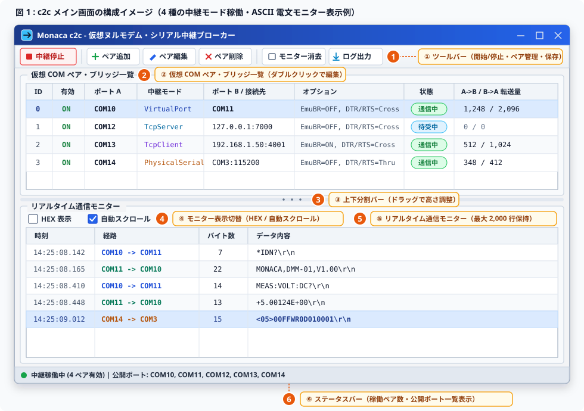
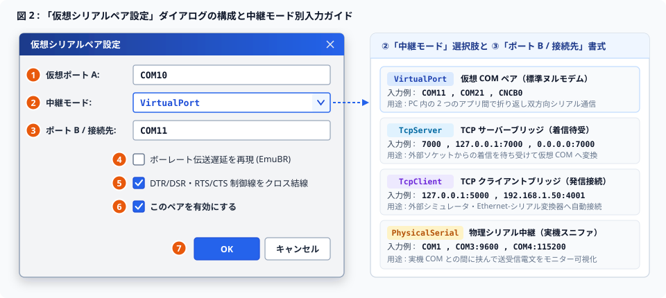
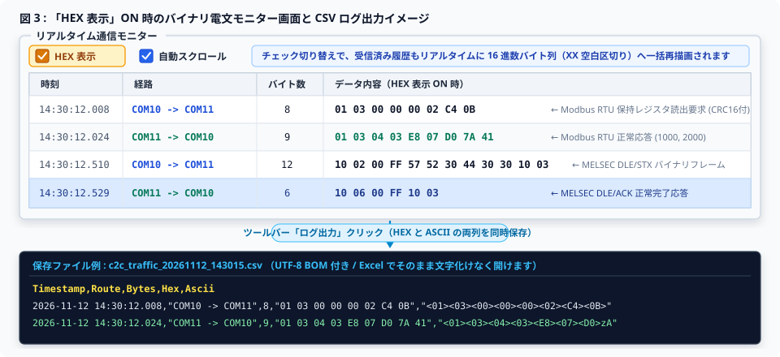
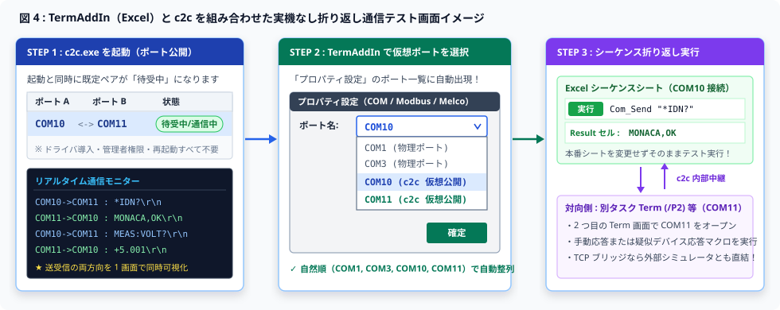
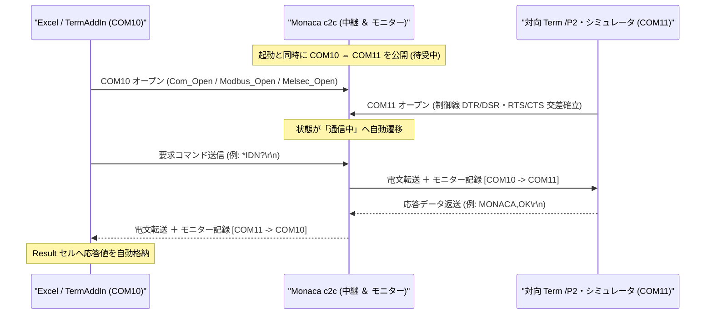

# c2c 操作説明書 (User Operation Manual)

👉 [← c2c 製品トップに戻る](../README.md)  
👉 [← TermAddIn 統合本体に戻る](https://github.com/Monaca-App/TermAddIn)

---

本ドキュメントは、カーネルドライバや管理者権限を一切必要とせず、Windows 標準ユーザー環境で仮想 COM ポート同士のヌルモデム（クロス）接続、TCP ブリッジ、物理シリアル中継（スニファ）、およびリアルタイム通信パケット監視を実現する **「Monaca c2c」** の操作説明書です。

---

# 目次

- [📖 1. 概要と基本動作](#-1-概要と基本動作)
  - [1.1 本ツールの役割と 3 つの利用シーン](#11-本ツールの役割と-3-つの利用シーン)
  - [1.2 起動方法と終了時の自動クリーンアップ](#12-起動方法と終了時の自動クリーンアップ)
- [🖥️ 2. メイン画面の構成と各部の機能](#️-2-メイン画面の構成と各部の機能)
  - [2.1 メイン画面全体イメージ](#21-メイン画面全体イメージ)
  - [2.2 ① 上部ツールバーの各ボタン説明](#22--上部ツールバーの各ボタン説明)
  - [2.3 ② 仮想 COM ペア・ブリッジ一覧（上段ペイン）の見方](#23--仮想-com-ペアブリッジ一覧上段ペインの見方)
  - [2.4 ③〜⑤ リアルタイム通信モニター（下段ペイン）と ⑥ ステータスバー](#24--リアルタイム通信モニター下段ペインと--ステータスバー)
- [🔀 3. 仮想ポートペア・ブリッジの追加と編集](#-3-仮想ポートペアブリッジの追加と編集)
  - [3.1 「仮想シリアルペア設定」ダイアログの操作手順](#31-仮想シリアルペア設定ダイアログの操作手順)
  - [3.2 4 つの中継モード別の設定方法と入力例](#32-4-つの中継モード別の設定方法と入力例)
  - [3.3 通信エミュレーションオプション（EmuBR・制御線クロス結線）](#33-通信エミュレーションオプションemubr制御線クロス結線)
  - [3.4 入力チェック（バリデーション）メッセージと対処方法](#34-入力チェックバリデーションメッセージと対処方法)
- [🔍 4. リアルタイム通信モニターの活用とログ保存](#-4-リアルタイム通信モニターの活用とログ保存)
  - [4.1 ASCII 表示モードと制御コードの可視化ルール](#41-ascii-表示モードと制御コードの可視化ルール)
  - [4.2 HEX 表示モードへの切り替え（バイナリ電文解析）](#42-hex-表示モードへの切り替えバイナリ電文解析)
  - [4.3 通信モニター履歴の CSV / テキスト保存](#43-通信モニター履歴の-csv--テキスト保存)
- [🚀 5. 実践ガイド：TermAddIn / Term と連携した通信テスト手順](#-5-実践ガイドtermaddin--term-と連携した通信テスト手順)
  - [5.1 シナリオ A：実機なしで Excel シーケンスを折り返しテストする](#51-シナリオ-a実機なしで-excel-シーケンスを折り返しテストする)
  - [5.2 シナリオ B：実機の物理 COM ポート通信を傍受・モニターする（スニファ運用）](#52-シナリオ-b実機の物理-com-ポート通信を傍受モニターするスニファ運用)
  - [5.3 シナリオ C：外部の TCP/IP 機器シミュレータと接続する](#53-シナリオ-c外部の-tcpip-機器シミュレータと接続する)
- [⌨️ 6. コマンドライン（CLI）モードの操作リファレンス](#️-6-コマンドラインcliモードの操作リファレンス)
  - [6.1 CLI サブコマンド・オプション一覧](#61-cli-サブコマンドオプション一覧)
  - [6.2 バッチ・自動テストスクリプトからの活用例](#62-バッチ自動テストスクリプトからの活用例)
- [⚙️ 7. 設定ファイルの管理とトラブルシューティング（FAQ）](#️-7-設定ファイルの管理とトラブルシューティングfaq)
  - [7.1 設定ファイル・稼働管理ファイル・監査ログの保存場所](#71-設定ファイル稼働管理ファイル監査ログの保存場所)
  - [7.2 よくある質問と対処方法（FAQ）](#72-よくある質問と対処方法faq)

---

## 📖 1. 概要と基本動作

### 1.1 本ツールの役割と 3 つの利用シーン
**Monaca c2c** は、実機の計測器・PLC・組込基板や RS-232C クロスケーブルが手元にない環境でも、PC 1 台だけでシリアル通信テストを完結できる公式コンパニオンツールです。カーネルドライバの導入や OS 再起動を必要とせず、以下の 3 つの場面でそのまま活用できます。

1. **実機なしの PC 内折り返し通信テスト（仮想 COM ペア）**:
   仮想ポート同士（例: `COM10` ⇔ `COM11`）を内部で直結し、片側に Excel アドイン **[TermAddIn](https://github.com/Monaca-App/TermAddIn)** （[COM シリアル通信](https://github.com/Monaca-App/TermAddIn_Comm) / [Modbus RTU・ASCII](https://github.com/Monaca-App/TermAddIn_Modbus) / [MELSEC 計算機リンク](https://github.com/Monaca-App/TermAddIn_Melco)）、もう片側に別タスクの **Term** や応答マクロを接続してシーケンスを事前検証できます。
2. **ネットワーク機器・外部シミュレータとの相互変換（TCP ブリッジ）**:
   TCP/IP ソケット通信を行う外部の機器エミュレータや Ethernet-シリアル変換器を仮想 COM ポートへ変換し、シリアル専用シーケンスからそのまま制御できます。
3. **実機シリアル通信の電文監視・エビデンス採取（物理シリアル中継）**:
   通信アプリと物理 COM ポートの間に **c2c** を中継挿入することで、実機との間でやり取りされる全パケット（ASCII / HEX）をミリ秒精度で可視化・CSV 保存できます。

### 1.2 起動方法と終了時の自動クリーンアップ
* **GUI モード起動**: フォルダ内の **`c2c.exe`** をダブルクリック（引数なしで実行）すると、メイン画面が開き、有効化されているすべてのペアの中継が **自動的に開始** されます。
* **初回起動時の初期ペア**: 設定ファイルがまだ存在しない初回起動時は、標準の仮想 COM ペア **`COM10` ⇔ `COM11`** が自動生成され、すぐに使い始められます。
* **安全な終了処理**: ウィンドウ右上の `[×]` ボタンで **c2c** を閉じると、すべての中継通信が安全に停止し、公開されていた仮想ポート情報も自動的に解除されます（デバイスマネージャーやレジストリに不要なゴミ情報が残ることはありません）。

---

## 🖥️ 2. メイン画面の構成と各部の機能

### 2.1 メイン画面全体イメージ
`c2c.exe` を起動すると、以下のメイン画面が表示されます。画面は **上部ツールバー** 、 **仮想 COM ペア・ブリッジ一覧（上段）** 、 **リアルタイム通信モニター（下段）** 、および **下部ステータスバー** の 4 領域で構成されています。



---

### 2.2 ① 上部ツールバーの各ボタン説明
画面上部のツールバーには、中継の一括開始・停止、ペア設定の追加・編集・削除、およびモニター履歴の消去・保存を行うボタンが配置されています。

| ボタン表示名 | アイコン・状態変化 | 機能と動作内容 |
| :--- | :--- | :--- |
| **中継開始 / 中継停止** | トグル切替ボタン<br>（稼働中は **「中継停止」** 、停止中は **「中継開始」** と表示） | 有効（`ON`）になっているすべてのペアの中継処理を一括で開始または停止します。<br>・アプリ起動時は自動的に中継が開始された状態（ボタン表示は **「中継停止」** ）になります。<br>・一時的に仮想ポートの公開を止めたい場合は **「中継停止」** をクリックし、再開する際は **「中継開始」** をクリックします。 |
| **ペア追加** | `＋` アイコン | 新しい仮想ポートペアまたはブリッジを追加するための「仮想シリアルペア設定」ダイアログを開きます。新しいペアには未使用の連番ポート名（例: `COM12` ⇔ `COM13`）が初期候補として自動入力されます。 |
| **ペア編集** | 編集アイコン | 上段の一覧で現在選択されている行の設定ダイアログを開きます。設定を変更して `[OK]` を押すと即座にファイルへ保存され、中継稼働中であれば新しい設定で自動的に再起動・反映されます。<br>※ 一覧の行を **ダブルクリック** しても同じ編集ダイアログが開きます。 |
| **ペア削除** | `×` アイコン | 上段の一覧で選択されているペアを、確認メッセージ（`選択中の仮想ポートペア [#0 (COM10 <-> COM11)] を削除しますか？`）で `[はい]` を選んだ後に削除します。稼働中の場合は自動的に中継構成が更新されます。 |
| **モニター消去** | クリアアイコン | 下段の「リアルタイム通信モニター」に表示されているパケット履歴をすべて消去し、画面をクリアします（これから新しいテストを実行する前の画面整理に便利です）。 |
| **ログ出力** | 保存アイコン | 現在「リアルタイム通信モニター」に保持されているパケット履歴を、ファイル保存ダイアログから **CSV ファイル（`.csv`）** または **テキストファイル（`.txt`）** として保存します。 |

---

### 2.3 ② 仮想 COM ペア・ブリッジ一覧（上段ペイン）の見方
登録されているすべての仮想ポートペアおよびブリッジの構成と稼働状況がリアルタイムに一覧表示されます（稼働状況と転送量は 0.5 秒周期および状態変化時に自動更新されます）。

| 列名 | 表示例 | 内容説明 |
| :--- | :--- | :--- |
| **ID** | `0`, `1`, `2` | ペアごとに自動採番される識別番号（0 以上の整数）です。CLI コマンドでの有効化・削除指定にも使用できます。 |
| **有効** | `ON` / `OFF` | そのペアが中継対象として有効化されているかどうかを示します。`OFF` のペアは設定を残したまま公開対象から除外されます。 |
| **ポート A** | `COM10` | **[TermAddIn](https://github.com/Monaca-App/TermAddIn)** や **Term** などの通信アプリケーション側へ公開される仮想 COM ポート名です。 |
| **中継モード** | `VirtualPort`<br>`TcpServer`<br>`TcpClient`<br>`PhysicalSerial` | 対向側（エンドポイント B）の中継方式を示します（詳細は [第 3.2 節](#32-4-つの中継モード別の設定方法と入力例) を参照）。 |
| **ポート B / 接続先** | `COM11`<br>`127.0.0.1:7000`<br>`COM3:115200` | 対向側の仮想 COM ポート名、TCP ホスト・ポート番号、または物理シリアルポート名とボーレート指定を表示します。 |
| **オプション** | `EmuBR=OFF, DTR/RTS=Cross` | ボーレート遅延再現（`EmuBR=ON` / `OFF`）および制御線結線方式（`DTR/RTS=Cross` / `Thru`）の設定状態を表示します。 |
| **状態** | `通信中` / `待受中`<br>`停止` / `無効` | 現在のリアルタイム接続状態を表示します。<br>・ **`通信中`** : クライアントアプリが仮想ポートをオープンして接続が確立している状態<br>・ **`待受中`** : 中継サーバーが起動し、通信アプリからのポートオープンを待っている状態<br>・ **`停止`** : ツールバーで中継全体が停止されている状態<br>・ **`無効`** : ペア設定の「このペアを有効にする」が OFF の状態 |
| **A->B / B->A 転送量** | `1,248 / 2,096` | 中継開始以降に「ポート A から B 方向へ転送した累計バイト数」と「B からポート A 方向へ転送した累計バイト数」をカンマ区切りで表示します。中継を停止・再起動すると `0 / 0` にリセットされます。 |

---

### 2.4 ③〜⑤ リアルタイム通信モニター（下段ペイン）と ⑥ ステータスバー
* **③ 上下分割バー（スプリッター）**:
  上段の「仮想 COM ペア・ブリッジ一覧」と下段の「リアルタイム通信モニター」の境界線をマウスで上下にドラッグすると、見やすい高さ比率へ自在に調整できます。
* **④ モニター表示切替バー**:
  * **`HEX 表示` チェックボックス**: OFF（既定）ではテキスト・制御記号による ASCII 表示、ON にすると空白区切りの 16 進数バイト列（HEX ダンプ）表示へ即座に切り替わります。
  * **`自動スクロール` チェックボックス**: ON（既定）にしておくと、新しい電文が通過するたびにモニター一覧の最下行へ自動的にスクロールします。過去の行をじっくり確認したいときはチェックを一時的に外すことでスクロール位置を固定できます。
* **⑤ リアルタイム通信モニター一覧**:
  有効なすべてのペアを通過した通信パケットを、到着順に **最大 2,000 行** まで自動保持・表示します（2,000 行を超えると古い行から順に自動ローテーションされます）。各列には **「時刻（`HH:mm:ss.fff`）」** 、 **「経路（例: `COM10 -> COM11`）」** 、 **「バイト数」** 、および等幅フォントの **「データ内容」** が表示されます。
* **⑥ 下部ステータスバー**:
  画面最下部に、現在の中継稼働ステータス、有効ペア数、およびシステム内で公開中の仮想ポート名一覧（例: `中継稼働中 (4 ペア有効) | 公開ポート: COM10, COM11, COM12, COM13, COM14`）が表示されます。ログ保存実行時には保存先ファイルパスが通知されます。

---

## 🔀 3. 仮想ポートペア・ブリッジの追加と編集

### 3.1 「仮想シリアルペア設定」ダイアログの操作手順
ツールバーの **「ペア追加」** ボタン、または一覧行を選択して **「ペア編集」** ボタン（もしくは行のダブルクリック）を実行すると、以下の **「仮想シリアルペア設定」** ダイアログが開きます。



1. **① `仮想ポート A:`** に、公開したい仮想 COM ポート名（例: `COM10`、`COM20`）を入力します（小文字 `com10` や空白付きで入力しても確定時に自動で大文字正規化されます）。
2. **② `中継モード:`** のドロップダウンから、目的に合ったモード（4 種類）を選択します。
3. **③ `ポート B / 接続先:`** に、選択した中継モードに対応する対向ポート名または接続先アドレスを入力します（欄を空にした状態で中継モードを切り替えると、そのモードの代表的な入力例が自動補完されます）。
4. 必要に応じて **④ `ボーレート伝送遅延を再現 (EmuBR)`** 、 **⑤ `DTR/DSR・RTS/CTS 制御線をクロス結線`** 、および **⑥ `このペアを有効にする`** のチェックを設定します。
5. **⑦ `[ OK ]`** ボタンをクリックすると入力内容が検証・保存され、即座に一覧と中継動作へ反映されます（変更を取りやめる場合は **`[ キャンセル ]`** を押します）。

---

### 3.2 4 つの中継モード別の設定方法と入力例

選択する **「中継モード」** ごとの動作イメージと、 **「ポート B / 接続先」** 欄への具体的な指定書式は以下の通りです。

| 中継モード | 公開される仮想ポート | 「ポート B / 接続先」の入力書式と具体例 | 詳しい動作と活用ポイント |
| :--- | :--- | :--- | :--- |
| **`VirtualPort`**<br>（仮想 COM ペア） | **ポート A と ポート B の両方**<br>（例: `COM10` と `COM11`） | 任意の仮想ポート名<br>・`COM11`<br>・`COM21`<br>・`CNCB0`（com0com 互換名も可） | **【最も標準的な PC 内折り返しモード】**<br>ポート A に書き込んだデータがそのままポート B から受信され、ポート B に書き込んだデータがポート A から受信されます。物理 COM ポート（例: `COM1` 等）と重ならない `COM10` 以降の番号を推奨します。 |
| **`TcpServer`**<br>（TCP サーバーブリッジ） | **ポート A のみ**<br>（例: `COM12`） | `<ポート番号>` または `<待受IP>:<ポート番号>`<br>・`7000`（ローカル待受）<br>・`127.0.0.1:7000`（同一 PC 限定）<br>・`0.0.0.0:7000`（LAN 内全許可） | **【外部 TCP クライアントの着信待受】**<br>指定した TCP ポートでソケット接続を待ち受けます。Python スクリプトやネットワーク通信ツールからその TCP ポートへ接続すると、仮想ポート A（`COM12`）と双方向でデータ中継されます。 |
| **`TcpClient`**<br>（TCP クライアントブリッジ） | **ポート A のみ**<br>（例: `COM13`） | `<接続先ホストまたはIP>:<ポート番号>`<br>・`127.0.0.1:5000`<br>・`192.168.1.50:4001` | **【外部 TCP サーバー・変換器への自動接続】**<br>仮想ポート A がオープンされると同時に、指定した外部 TCP サーバー（計測器シミュレータやシリアルデバイスサーバー等）へ自動発信接続して双方向中継します。 |
| **`PhysicalSerial`**<br>（物理シリアル中継） | **ポート A のみ**<br>（例: `COM14`） | `<物理COM名>` または `<物理COM名>:<ボーレート>`<br>・`COM1`（既定 9600 bps）<br>・`COM3:9600`<br>・`COM4:115200` | **【実機シリアル通信のスニファ監視】**<br>アプリ側を仮想ポート A（`COM14`）に接続させ、 **c2c** が背後の物理ポート（`COM3` 等）をオープンして実機と中継します。アプリの設定をほとんど変えずに実機との生電文を全てモニター・記録できます。 |

---

### 3.3 通信エミュレーションオプション（EmuBR・制御線クロス結線）

* **④ `ボーレート伝送遅延を再現 (EmuBR)`**:
  * **OFF（既定）**: メモリ速度で即座に高速転送します。通常の機能確認や大量ステップの高速自動回帰テストに適しています。
  * **ON**: 通信アプリ側が設定したボーレート（例: `9600 bps` なら 1 バイト＝約 10 ビット分で約 1.04 ミリ秒）に基づき、送信データ長に応じた実機同等の伝送ウェイトを挿入します。「高速な仮想通信では成功するのに、低速な実機 RS-232C につなぐと受信タイムアウトや電文の分割受信が起きる」といったタイミング問題の事前再現・検証に威力を発揮します。
* **⑤ `DTR/DSR・RTS/CTS 制御線をクロス結線`** （※ `VirtualPort` モード選択時のみ有効）:
  * **ON（既定）**: 市販の RS-232C ヌルモデム（クロス）ケーブルと同じく、ポート A の `DTR` 出力をポート B の `DSR`（および `CD`）入力へ、`RTS` 出力をポート B の `CTS` 入力へ（逆方向も同様に）リアルタイム交差結線します。ハードウェアフロー制御（`RTS/CTS`）を使用する機器シーケンスもそのままテスト可能です。
  * **OFF**: 制御線の交差連動を行いません。`VirtualPort` 以外のモード（TCP ブリッジや物理シリアル中継）を選択すると、本チェックボックスは自動的にグレーアウト（選択不可）となります。
* **⑥ `このペアを有効にする`**:
  * チェックを外すと、設定内容を消さずにそのペアを一時休止（状態：`無効`）にできます。よく使う複数のテスト環境構成を登録しておき、必要なペアだけ `ON` にして切り替える運用に便利です。

---

### 3.4 入力チェック（バリデーション）メッセージと対処方法
`[OK]` 押下時に設定内容に不備や重複がある場合、警告ダイアログが表示されて誤登録を未然に防ぎます。

| 表示されるメッセージ | 原因と修正方法 |
| :--- | :--- |
| **`仮想ポート A の名前を入力してください。`** | 「仮想ポート A」欄が空欄です。`COM10` などのポート名を入力してください。 |
| **`ポート B または接続先を指定してください。`** | 「ポート B / 接続先」欄が空欄です。対向ポート名または接続先アドレスを入力してください。 |
| **`ポート A とポート B に同一のポート名は指定できません。`** | `VirtualPort` モードでポート A とポート B に同じ名前（例: 両方 `COM10`）が入力されています。異なる 2 つのポート名（例: `COM10` と `COM11`）を指定してください。 |
| **`仮想ポート [COMxx] は既に他のペアで使用されています。`** | 登録済みの別ペアで同じ仮想ポート名が既に使われています。一覧を確認し、重複しない別のポート番号を指定してください。 |

---

## 🔍 4. リアルタイム通信モニターの活用とログ保存

### 4.1 ASCII 表示モードと制御コードの可視化ルール
モニター上部の **`HEX 表示`** にチェックが入っていない状態（既定）では、SCPI コマンドや汎用テキストプロトコルが読みやすい **可視 ASCII モード** で表示されます。目に見えない改行コードやバイナリ制御文字も、以下のように明確なエスケープ記号で可視化されるため、「改行が CR のみなのか CR+LF なのか」を一目で判別できます。

| 受信バイト値 | モニター上の表示 | 意味 |
| :---: | :---: | :--- |
| `0x0D` | **`\r`** | キャリッジリターン（CR） |
| `0x0A` | **`\n`** | ラインフィード（LF） |
| `0x09` | **`\t`** | 水平タブ（TAB） |
| `0x20` 〜 `0x7E` | そのままの文字（例: `*IDN?`） | 印字可能な標準 ASCII 文字 |
| 上記以外のバイト | **`<XX>`** （例: `<02>`, `<05>`, `<FF>`） | STX（`<02>`）、ETX（`<03>`）、ENQ（`<05>`）、ACK（`<06>`）などの制御コードおよび非 ASCII バイナリ値を 2 桁の 16 進数山括弧で明示 |

> [!TIP]
> 1 パケットが 256 バイトを超える長大なフレームの場合、画面描画の高速性を保つため画面上では先頭 256 バイト分を表示して末尾に `...` を付与します（CSV ログ出力時には最大 512 バイト分まで拡大出力されます）。

---

### 4.2 HEX 表示モードへの切り替え（バイナリ電文解析）
Modbus RTU や三菱電機 MELSEC 計算機リンク（形式 5 バイナリ）など、16 進数バイトフレームのプロトコルを検証する場合は、モニター上部の **`HEX 表示`** にチェックを入れます。



* チェックを切り替えた瞬間、これから届くパケットだけでなく **すでにモニター一覧に表示されている過去の全パケットも一括して 16 進数ダンプ表記（`01 03 00 00 00 02 C4 0B` 等）へリアルタイムに再描画** されます。
* 再度チェックを外せばいつでも元の ASCII 表示へ戻せるため、テキストとバイナリが混在する通信でも自在に見比べることができます。

---

### 4.3 通信モニター履歴の CSV / テキスト保存
検査エビデンスの保管やプロトコル不具合の原因解析のために通信履歴を保存したい場合は、上部ツールバーの **「ログ出力」** ボタンをクリックします。

1. ファイル保存ダイアログが開き、既定のファイル名として日時入りの `c2c_traffic_YYYYMMDD_HHMMSS.csv` が自動提案されます。
2. 保存先フォルダを選んで `[保存]` を押すと、文字化けしない **UTF-8（BOM 付き）形式** でファイルが出力されます（Excel でそのままダブルクリックして開くことができます）。
3. 出力ファイルには、画面上の `HEX 表示` チェック状態にかかわらず **16 進数ダンプ列（`Hex`）と可視 ASCII 列（`Ascii`）の両方が同時に出力** されるため、後からどちらの形式でも完全に解析できます。

| CSV カラム名 | 出力データの例 | 内容 |
| :--- | :--- | :--- |
| **`Timestamp`** | `2026-11-12 14:30:12.008` | ミリ秒単位のパケット通過日時 |
| **`Route`** | `"COM10 -> COM11"` | 送信元ポートから宛先ポートへの転送経路 |
| **`Bytes`** | `8` | パケットの正確なバイト長 |
| **`Hex`** | `"01 03 00 00 00 02 C4 0B"` | 空白区切りの 16 進数バイト列 |
| **`Ascii`** | `"<01><03><00><00><00><02><C4><0B>"` | 制御文字エスケープ済みの可視 ASCII 文字列 |

---

## 🚀 5. 実践ガイド：TermAddIn / Term と連携した通信テスト手順

### 5.1 シナリオ A：実機なしで Excel シーケンスを折り返しテストする
実機や変換ケーブルが一切ない PC 1 台の環境で、Excel の **[TermAddIn](https://github.com/Monaca-App/TermAddIn)** シーケンスと対向側の別タスク **Term** を仮想ペア（`COM10` ⇔ `COM11`）でつないで双方向テストを行う最も基本的な手順です。



#### 手順ステップ
1. **`c2c.exe` を起動して仮想ペアを公開する**:
   * `c2c.exe` を起動し、上段一覧で `COM10` ⇔ `COM11`（`VirtualPort`）の状態が **「待受中」** になっていることを確認します。
2. **Excel 側（TermAddIn）を `COM10` に設定する**:
   * Excel を開き、リボンの **「ツール起動」** からメイン画面を表示し、ツールバーの **「プロパティ設定」** を開きます。
   * 使用するプロトコルのタブ（COM シリアル / Modbus RTU・ASCII / MELSEC 計算機リンク）を開き、 **「ポート名」ドロップダウン** をクリックします。
   * リスト内に自動追加されている **`COM10`** を選んで **`[確定]`** を押します（※ すでにプロパティ設定画面を開いたまま後から `c2c` を起動した場合は、一度プロパティ設定画面を開き直すと最新の仮想ポート一覧が読み込まれます）。
3. **対向側（別タスクの `Term.exe`）を `COM11` に接続する**:
   * 疑似応答役として `Term.exe /P2`（タスク 2）を起動し、同様に「プロパティ設定」で対向側の **`COM11`** を選択して **「接続開始」** を押します。
   * この時点で、 **c2c** の状態列が自動的に緑色の **「通信中」** に変わります。
4. **シーケンスを実行して応答とモニターを確認する**:
   * Excel シート上の **[ 実行 ]** ボタン（または一括 **Start** ボタン）を押してコマンドを送信します。
   * 対向のタスク 2 画面に送信コマンドが届き、タスク 2 から応答文字列（または応答マクロ）を返すと、Excel シートの **Result（結果セル）** に受信データが記録されます。同時に **c2c** 下段の通信モニターで往復の全電文と応答時間差（ミリ秒）を確認できます。



---

### 5.2 シナリオ B：実機の物理 COM ポート通信を傍受・モニターする（スニファ運用）
実機（例: 物理 `COM3` に接続された PLC や計測器）との通信がうまくいかないときに、配線や分岐ケーブルを用意することなくソフトウェアだけで送受信電文を丸ごと可視化する手順です。

1. 通信アプリ側が物理 `COM3` を開いている場合は、いったん **「切断（クローズ）」** します。
2. **c2c** のツールバーから **「ペア追加」** を押し、以下のように設定して **`[OK]`** を押します。
   * **仮想ポート A**: `COM14`（任意の未使用番号）
   * **中継モード**: `PhysicalSerial`
   * **ポート B / 接続先**: `COM3:9600`（実機の物理 COM 番号とボーレートをコロン区切りで指定）
3. **[TermAddIn](https://github.com/Monaca-App/TermAddIn)** 側のプロパティ設定で、接続先ポートを一時的に `COM3` から **`COM14`** へ変更してシーケンスを実行します。
4. アプリ ⇔ `COM14` ⇔ **c2c** ⇔ 物理 `COM3`（実機）の経路でそのまま実機通信が行われ、 **c2c** のリアルタイム通信モニター上で実機との全要求・全応答バイト列をミリ秒単位で追跡・CSV 保存できます。

---

### 5.3 シナリオ C：外部の TCP/IP 機器シミュレータと接続する
Python や C# などで作成した自作の TCP ソケット応答プログラムや、ネットワーク越しのシリアル変換器と仮想 COM ポートを直結する手順です。

* **外部プログラム側から `c2c` へ接続させる場合（`TcpServer` モード）**:
  1. **c2c** の「ペア追加」で、仮想ポート A に `COM12`、中継モードに **`TcpServer`** 、接続先に `127.0.0.1:7000` を設定します。
  2. TermAddIn 側は `COM12` をオープンし、自作シミュレータ側は TCP クライアントとして `127.0.0.1:7000` へソケット接続するだけで双方向シリアル通信が開通します。
* **`c2c` から外部サーバーへ自動接続する場合（`TcpClient` モード）**:
  1. 外部の機器エミュレータやデバイスサーバー（例: `192.168.1.50:4001`）を起動しておきます。
  2. **c2c** の「ペア追加」で、仮想ポート A に `COM13`、中継モードに **`TcpClient`** 、接続先に `192.168.1.50:4001` を設定します。
  3. TermAddIn 側で `COM13` をオープンすると、 **c2c** が自動的に `192.168.1.50:4001` へ接続して電文を中継します。

---

## ⌨️ 6. コマンドライン（CLI）モードの操作リファレンス

バッチファイルや PowerShell スクリプト、自動検査パイプラインから GUI を開かずに仮想ポートの登録・切り替え・バックグラウンド中継を行いたい場合は、`c2c.exe` にコマンドライン引数を渡して実行します。

### 6.1 CLI サブコマンド・オプション一覧

| コマンド構文 | 別名（エイリアス） | 機能と動作内容 | 終了コード |
| :--- | :---: | :--- | :---: |
| `c2c list` | `ls` | 登録済みの全ペア設定（ID・有効状態・ポート・モード・オプション）と、現在稼働公開中のポート一覧を表示します。 | `0`: 正常 |
| `c2c add <PortA> <PortB> [--emubr]` | `install` | 標準の仮想 COM ペア（`VirtualPort`）を追加します。末尾に `--emubr` を付けるとボーレート遅延再現を有効化します。 | `0`: 成功<br>`1`: 入力不備・重複 |
| `c2c add <PortA> --tcp <Port\|Host:Port> [--emubr]` | — | 仮想ポート A と指定 TCP 待受ポートを結ぶ `TcpServer` ブリッジを追加します。 | `0`: 成功 / `1`: 失敗 |
| `c2c add <PortA> --tcp-client <Host:Port> [--emubr]` | — | 仮想ポート A から指定 TCP サーバーへ接続する `TcpClient` ブリッジを追加します。 | `0`: 成功 / `1`: 失敗 |
| `c2c add <PortA> --serial <COMx[:Baud]> [--emubr]` | — | 仮想ポート A と物理シリアルポートを結ぶ `PhysicalSerial` 中継ブリッジを追加します。 | `0`: 成功 / `1`: 失敗 |
| `c2c remove <PairId\|PortName>` | `rm`, `uninstall` | ペア ID（例: `0`）またはポート名（例: `COM10`）を指定して該当ペア設定を削除します。 | `0`: 成功<br>`1`: 該当なし |
| `c2c enable <PairId\|PortName>` | — | 指定したペア ID またはポート名のペアを有効化（`ON`）します。 | `0`: 成功 / `1`: 該当なし |
| `c2c disable <PairId\|PortName>` | — | 指定したペア ID またはポート名のペアを無効化（`OFF`）します。 | `0`: 成功 / `1`: 該当なし |
| `c2c run` | `serve` | GUI 画面を表示せずコンソール上で中継サーバーを連続稼働し、通過パケットを `[HH:mm:ss.fff] COM10 -> COM11 (7B) *IDN?\r\n` 形式で標準出力へリアルタイム表示します（`Ctrl+C` で安全に停止）。 | `0`: 正常停止 |
| `c2c test` | `--test` | 仮想ポート公開・双方向データ転送・制御線クロス結線の自己診断テストを一括実行し、環境の正常性を確認します。 | `0`: `[PASS]` 合格<br>`1`: `[FAIL]` 失敗 |
| `c2c --help` | `-h`, `/?`, `help` | CLI モードの使用方法とサブコマンド一覧を表示します。 | `0`: 正常 |

---

### 6.2 バッチ・自動テストスクリプトからの活用例

```powershell
# 1. 環境の自己診断テストを実行し、正常動作を確認する
.\c2c.exe test

# 2. 自動テスト用の仮想 COM ペア (COM20 <-> COM21) をボーレート遅延再現付きで登録
.\c2c.exe add COM20 COM21 --emubr

# 3. 物理 COM3 (115200bps) の通信スニファ用ポート COM24 を登録
.\c2c.exe add COM24 --serial COM3:115200

# 4. 現在の登録設定と公開中ポートを確認
.\c2c.exe list

# 5. 不要になったペアをポート名指定で削除
.\c2c.exe remove COM24

# 6. コンソール上でヘッドレス中継サーバーを起動（Ctrl+C で終了）
.\c2c.exe run
```

---

## ⚙️ 7. 設定ファイルの管理とトラブルシューティング（FAQ）

### 7.1 設定ファイル・稼働管理ファイル・監査ログの保存場所
**c2c** が使用する設定ファイルおよび稼働情報ファイルは、Windows 標準のユーザープロファイル領域に自動保存されます（管理者権限は一切不要です）。

| ファイル種別 | 保存パス（環境変数表記） | 役割とライフサイクル |
| :--- | :--- | :--- |
| **ペア構成設定ファイル** | `%LOCALAPPDATA%\Monaca\c2c\c2c_pairs.xml` | 画面や CLI で追加・編集したペア一覧を保存する XML ファイルです。次回起動時にも前回の構成がそのまま自動復元されます。 |
| **稼働ポート公開ファイル** | `%LOCALAPPDATA%\Monaca\c2c\active_ports.txt` | **c2c** が中継稼働中の間のみ作成され、 **[TermAddIn](https://github.com/Monaca-App/TermAddIn)** や **Term** が利用可能な仮想ポートを自動検出するために参照します。中継停止時またはアプリ終了時に自動削除されます。 |
| **変更履歴・エラーログ** | `%USERPROFILE%\Desktop\Monaca\info.log`<br>*(既定の保存先)* | ペア設定を追加・変更・削除して保存した際の履歴や、TCP ポート競合・物理 COM オープン失敗などの診断情報が記録されます。 |

---

### 7.2 よくある質問と対処方法（FAQ）

#### Q1. TermAddIn の「プロパティ設定」を開いても、仮想ポート（`COM10` 等）がドロップダウンに表示されません。
* **確認 1**: **c2c** が起動しており、ステータスバーが **「中継稼働中」** になっているか確認してください（「中継停止中」になっている場合はツールバーの **「中継開始」** を押してください）。
* **確認 2**: 対象ペアの「有効」列が **`ON`** （状態が `待受中` または `通信中`）になっているか確認してください。
* **確認 3**: 先に「プロパティ設定」ダイアログを開いたまま、後から **c2c** を起動した場合は、一度「プロパティ設定」ダイアログを閉じてから再度開くと最新の公開ポートがリストに反映されます。

#### Q2. Windows デバイスマネージャーの「ポート (COM と LPT)」に `COM10` が表示されないのは正常ですか？
* **はい、正常な仕様です** 。本ツールは OS のカーネルドライバを一切使わずにユーザーモードで安全に仮想シリアル通信を実現しているため、デバイスマネージャーを汚しません。 **[TermAddIn](https://github.com/Monaca-App/TermAddIn)** および **Term** の各シリアル機能からは物理 COM ポートと全く同じように認識・接続できます。

#### Q3. 他の一般的なサードパーティ製ターミナルソフト（Tera Term 等）とも通信したい場合はどうすればよいですか？
* サードパーティ製ソフトが TCP/IP（Telnet / Raw ソケット）接続に対応している場合は、 **c2c** の中継モードを **`TcpServer`** （例: ポート A = `COM12`, 接続先 = `127.0.0.1:7000`）に設定してください。TermAddIn 側は仮想 COM（`COM12`）として接続し、外部ターミナルソフト側は `127.0.0.1` のポート `7000`（Raw / Telnet）へ接続することで、カーネルドライバなしのまま相互に通信・モニターできます。

#### Q4. リアルタイム通信モニターの「データ内容」に `<01><03><00>...` のような山括弧がたくさん表示されます。
* Modbus RTU などのバイナリプロトコルを ASCII モードで表示しているため、非印字バイトが `<XX>` 形式で安全にエスケープ表示されています。モニター上部の **`HEX 表示`** にチェックを入れると、見やすい 16 進数バイト列（`01 03 00 ...`）に切り替わります。

#### Q5. 物理シリアル中継（`PhysicalSerial`）で実機ポートを指定しましたが通信できません。
* 指定した物理 COM ポート（例: `COM3`）を他のアプリケーション（別の Term 画面やメーカー純正ツール等）がすでに開いて占有していないか確認してください。物理 COM ポートは 1 つのプロセスしか同時に開けないため、他のソフト側を切断してから **c2c** の「中継停止」➔「中継開始」を実行してください。また、`COM3:115200` のように実機側の通信ボーレートと一致しているかも確認してください。

#### Q6. ペア設定をすべて工場出荷時（初期状態）にリセットしたい場合はどうすればよいですか？
* `c2c.exe` を終了した状態で、エクスプローラーのアドレスバーに `%LOCALAPPDATA%\Monaca\c2c` と入力して開き、`c2c_pairs.xml` を削除してから `c2c.exe` を再起動してください。初期設定（`COM10` ⇔ `COM11`）が自動的に再生成されます。

---

## 🔗 関連ドキュメント・リンク

* **[c2c 製品トップ案内（README.md）](../README.md)**
* **[TermAddIn 総合案内（README.md）](https://github.com/Monaca-App/TermAddIn)**
  * [COM シリアル通信エクステンション（Comm）](https://github.com/Monaca-App/TermAddIn_Comm)
  * [Modbus 通信エクステンション（Modbus）](https://github.com/Monaca-App/TermAddIn_Modbus)
  * [三菱電機 MELSEC 計算機リンクエクステンション（Melco）](https://github.com/Monaca-App/TermAddIn_Melco)
* **[Monaca アプリ工房 ストアポータル](https://github.com/Monaca-App/store)**
