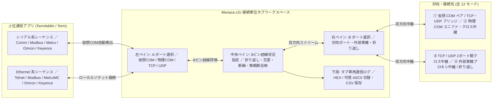



# c2c - ドライバ不要の仮想シリアル・Ethernet ポート中継＆通信モニターツール

👉 [← TermAddIn 統合本体に戻る](https://github.com/Monaca-App/TermAddIn)  
👉 [← Monaca アプリ工房（トップ）に戻る](https://github.com/Monaca-App/store)

---

[](https://www.microsoft.com/)
[](https://github.com/Monaca-App/TermAddIn)
[](https://dotnet.microsoft.com/)
[]()
[]()

## 📖 概要

**c2c** は、実機の RS-232C クロスケーブル・USB-シリアル変換器やネットワーク上の PLC・計測器が手元にない環境でも、PC 1 台で **仮想 COM ポート通信（8ピン仮想ケーブル結線対応）** と **Ethernet（TCP / UDP）ポート通信** の双方を模擬・中継・監視できる **ドライバ不要の仮想シリアル・Ethernet 中継＆リアルタイム通信モニターツール** です。

従来の仮想シリアルドライバ（`com0com` 等）やパケットキャプチャドライバで課題となっていたカーネルモードドライバのインストール、テスト署名モード変更、OS 再起動、および管理者権限を一切必要としません。 **c2c** を起動するだけで、Excel 通信制御アドイン **[TermAddIn](https://github.com/Monaca-App/TermAddIn)** のシリアル系（[Comm](https://github.com/Monaca-App/TermAddIn_Comm)・[Modbus RTU/ASCII](https://github.com/Monaca-App/TermAddIn_Modbus)・[MELSEC 計算機リンク](https://github.com/Monaca-App/TermAddIn_Melco)・[オムロン HostLink](https://github.com/Monaca-App/TermAddIn_Omron)・[キーエンス KV 上位リンク](https://github.com/Monaca-App/TermAddIn_Keyence)）と Ethernet 系（[Telnet / ソケット](https://github.com/Monaca-App/TermAddIn_Telnet)・[Modbus TCP](https://github.com/Monaca-App/TermAddIn_Modbus)・[MELSEC MC プロトコル](https://github.com/Monaca-App/TermAddIn_MelcoMC)・[オムロン FINS](https://github.com/Monaca-App/TermAddIn_Omron)・[キーエンス KV 上位リンク](https://github.com/Monaca-App/TermAddIn_Keyence)）の全 **7 エクステンション** および姉妹エミュレータ **[TermEmulator](https://github.com/Monaca-App/TermEmulator)** と連携し、実機と全く同じ操作感の開発・デバッグ・自動回帰テストを実行できます。

> [!IMPORTANT]
> ### 💡 本ツール最大の設計思想・特長
> **「カーネルドライバ完全不要・管理者権限ゼロ —— 1 接続＝ 1 タブの独立ワークスペースで 8 ピン結線指定から回線別パケット監視まで一画面完結」**
> 
> * **OS 環境を一切汚さないクリーン設計**: Windows 11 環境（セキュアブート・メモリ整合性 HVCI 有効）や企業の管理 PC でも、システム設定の変更やドライバ導入を一切行わずに展開直後から安全に稼働します。
> * **接続単位タブ管理 ＆ 上段三分割（Aポート ／ 8ピン結線 ／ Bポート）＋ 下段タブ専用通信ログ**: 1 つの接続ペアを 1 つのタブで独立管理し、別ダイアログを開かずに左右ポート選択と **RS-232C 8ピン結線（折り返しクロス・フルハンドシェイク・3線式・ストレート・ピンクリック個別結線）** を直感指定できます。下段にはそのタブ専用の通信ログが表示されるため、複数回線を同時稼働させてもログが混在しません。



---

## ✨ 主な機能・特徴

### 1. カーネルドライバ完全不要 ＆ 標準ユーザー権限で即時稼働
* デバイスマネージャーへの仮想ドライバ登録や Windows テストモード変更が不要なため、業務用のノート PC や検査ラインの制限アカウント環境でもそのまま起動して利用できます。
* アプリケーションを終了するだけで公開ポート情報と待受ソケットが自動的にクリーンアップされ、OS 側に不要な仮想デバイスが残存しません。

### 2. 1 接続＝ 1 タブの独立管理 ＆ 上段三分割インライン設定 UI
* **「＋ 接続追加」** で新しい接続タブを即座に追加し、タブ右上の **「削除」** ボタンで **他のタブで通信中の回線を一切瞬断させずに** 当該タブのみを停止・削除できます。
* 各タブの上半分を **左：Aポート選択 ／ 中央：8ピン結線状況指定 ／ 右：Bポート選択** の三分割レイアウトで構成しており、設定ダイアログを開閉することなく一画面で直感的に構成・変更できます。

### 3. RS-232C 8 ピン仮想ケーブル結線（プリセット 4 種 ＋ ピンクリック自由結線）
* **8 ピン（`TXD`, `RXD`, `RTS`, `CTS`, `DSR`, `SG`, `DCD`, `DTR`）** の結線状態を対向コネクタ図で視覚的に表示・操作できます。
* 既定の **「折り返しクロス（RTS-CTS / DTR-DSR 自局折り返し）」** をはじめ、 **「フルハンドシェイク交差」** 、 **「3 線式最小クロス」** 、 **「ストレート結線」** の 4 プリセットに加え、キャンバス上のピン丸印をクリックして **任意のピン間結線や特定信号線（`SG`・`CTS`・`DCD` 等）の断線テスト** を通信継続中のまま無瞬断で反映できます。

### 4. シリアル・COM ブリッジ 6 モード ＋ Ethernet ポート模擬 7 モードの計 13 モード搭載
* **シリアル・COM ブリッジ系（6 モード）**: 仮想 COM 同士のヌルモデム接続、仮想 COM ⇔ TCP サーバー／クライアント／UDP ブリッジ、仮想 COM ⇔ 物理シリアル中継、および物理 COM A ⇔ 物理 COM B クロス中継に対応します。
* **Ethernet ポート模擬系（7 モード）**: TCP および UDP の双方について、 **2 ポート間クロス中継（`A <-> B`）** 、実機 PLC・計測器との間に挟む **外部機器プロキシ中継（パケットスニファ）** 、対向アプリ不要の **単一ポート折り返し（`Loopback`）** 、さらに 2 つの外部 TCP サーバー同士を中継する **TCP クライアント対向中継（`Host A <-> Host B`）** を備えています。

### 5. Term / TermAddIn 全 7 通信エクステンション＆ TermEmulator とのシームレス連携
* **シリアル系自動検出**: **c2c** で接続タブを有効化すると、稼働中の仮想 COM ポート名が **[TermAddIn](https://github.com/Monaca-App/TermAddIn)** （[Comm](https://github.com/Monaca-App/TermAddIn_Comm) / [Modbus](https://github.com/Monaca-App/TermAddIn_Modbus) / [Melco](https://github.com/Monaca-App/TermAddIn_Melco) / [Omron](https://github.com/Monaca-App/TermAddIn_Omron) / [Keyence](https://github.com/Monaca-App/TermAddIn_Keyence)）のポート選択ドロップダウンに自然順で自動表示されます。
* **Ethernet 系ソケット直結**: [Telnet / ソケット通信](https://github.com/Monaca-App/TermAddIn_Telnet)、[Modbus TCP](https://github.com/Monaca-App/TermAddIn_Modbus)、[MELSEC MC プロトコル](https://github.com/Monaca-App/TermAddIn_MelcoMC)、[OMRON FINS](https://github.com/Monaca-App/TermAddIn_Omron)、および [KEYENCE KV 上位リンク](https://github.com/Monaca-App/TermAddIn_Keyence) からは、`127.0.0.1:<Port>` を指定するだけで対向テストや実機プロキシ監視を行えます。また、姉妹ツール **[TermEmulator](https://github.com/Monaca-App/TermEmulator)** の仮想スレーブやインラインプロキシとも自在に組み合わせられます。

### 6. タブ専用の独立リアルタイム通信ログ ＆ 遅延エミュレーション（EmuBR / Latency）
* 各タブの下半分に **その接続専用の通信ログ** を備えており、複数回線を同時稼働させても他チャネルのポーリング電文が混ざらず、 **可視 ASCII 表示** と **16 進数（HEX）ダンプ表示** の即時切替・タブ別 CSV エクスポートが可能です。
* ボーレートに応じた伝送ウェイト再現（`EmuBR`）および任意の通信遅延（`0`〜`5,000` ms）を通信中にリアルタイム調整できます。

### 7. GUI モードと CLI モード（`--wiring` 対応）のハイブリッド稼働 ＆ 変更履歴記録
* 引数なし起動では **Windows GUI 管理画面** が立ち上がり、引数付き起動では **CLI モード** として 8 ピン結線指定（`--wiring`）を含む設定追加・削除・一覧確認・ヘッドレス連続中継・自己診断テストを実行できます。設定変更時は監査ログへ自動記録されます。

---

## 🔀 全 13 種類の中継・ポート模擬モード詳細

### 1. シリアル・仮想 COM ブリッジ系（全 6 モード）

| モード名称 | CLI 指定 | A ポート / B ポートの入力例 | 主な用途・動作イメージ |
| :--- | :---: | :--- | :--- |
| **COM <-> COM 仮想ヌルモデム** | *(既定)* | `A: COM10`<br>`B: COM11` | 1 台の PC 内で 2 つの仮想 COM ポートを 8 ピン仮想ケーブルで直結し、双方向通信・制御線連動を行います。 |
| **COM <-> TCP サーバー待受** | `--tcp` | `A: COM12`<br>`B: 127.0.0.1:7000` | 指定した TCP ポートでソケット着信を待ち受け、仮想 COM ポート A と双方向変換します（A 側の自局制御線折り返しも有効）。 |
| **COM <-> TCP クライアント接続** | `--tcp-client` | `A: COM13`<br>`B: 192.168.1.50:4001` | 外部 TCP サーバー（Ethernet-シリアル変換器等）へ自動接続し、仮想 COM ポート A として利用可能にします。 |
| **COM <-> UDP ブリッジ** | `--udp` | `A: COM14`<br>`B: 7000->127.0.0.1:7001` | 仮想 COM ポート A と UDP データグラム送受信を相互変換します。 |
| **COM <-> 物理シリアル中継** | `--serial` | `A: COM15`<br>`B: COM3:115200` | 仮想 COM ポート A と実機の物理 COM ポートを 8 ピン結線（ストレート透過等）で双方向中継し、全電文を可視化します。 |
| **物理 COM <-> 物理 COM 中継** | `--serial-cross` | `A: COM1:9600`<br>`B: COM2:9600` | 2 つの実機物理シリアルポート間をソフトウェア 8 ピン結線で中継し、実機間の往復電文・制御線をスニファ監視します。 |

### 2. Ethernet（TCP / UDP）ポート模擬系（全 7 モード）

| モード名称 | CLI 指定 | A ポート / B ポート（接続先）の入力例 | 主な用途・動作イメージ |
| :--- | :---: | :--- | :--- |
| **TCP 2ポート間クロス中継** | `--eth-tcp` | `A: 127.0.0.1:5000`<br>`B: 127.0.0.1:5001` | 2 つのローカル TCP 待受ポート間をクロス中継し、TermAddIn と対向 Term / 疑似 PLC スクリプトを直結します。 |
| **TCP 外部機器プロキシ中継** | `--eth-tcp-proxy` | `A: 127.0.0.1:1502`<br>`B: 192.168.1.10:502` | ローカル待受ポートから外部実機（PLC・計測器）へ透過プロキシ接続し、全往復パケットをスニファ監視します。 |
| **TCP 単一ポート折り返し** | `--eth-tcp-loop` | `A: 127.0.0.1:5002`<br>`B: Loopback` | 単一の TCP ポートへ送信したデータをそのまま同じ接続元へ即時エコー折り返しします（対向ソフト不要）。 |
| **TCP クライアント対向中継** | `--eth-tcp-client` | `A: 192.168.1.10:5000`<br>`B: 192.168.1.20:5000` | 2 つの外部 TCP サーバー（実機・エミュレータ等）へ双方クライアント接続し、双方向ストリーム中継・電文監視を行います。 |
| **UDP 2ポート間クロス中継** | `--eth-udp` | `A: 127.0.0.1:6000`<br>`B: 127.0.0.1:6001` | 2 つのローカル UDP 待受ポート間でデータグラムを相互クロス転送します。 |
| **UDP 外部機器プロキシ中継** | `--eth-udp-proxy` | `A: 127.0.0.1:6002`<br>`B: 192.168.1.10:5000` | MELSEC 3E UDP 等の外部実機との間に挟み、UDP データグラムを透過中継・モニター記録します。 |
| **UDP 単一ポート折り返し** | `--eth-udp-loop` | `A: 127.0.0.1:6003`<br>`B: Loopback` | 単一の UDP ポートで受信したデータグラムをそのまま送信元へ即時エコー返送します。 |

---

## 🖥️ GUI 画面の構成と操作方法

> [!TIP]
> **📘 GUI 画面イメージ付きの詳細マニュアル**  
> 接続単位タブ画面の各部名称、上段三分割の A / B ポート設定、8 ピン結線プリセット・ピンクリック結線ガイド、タブ別 HEX モニター、および TermAddIn 連携手順の画面イメージ付き解説は **[c2c 操作説明書](./Manual/c2c操作説明書.Md)** をご覧ください。

`c2c.exe` を引数なしで起動すると、メイン画面が表示され、有効（`ON`）に設定されているすべての接続タブの中継が自動的に開始されます。

### 1. 上部ツールバーおよび接続タブ内ヘッダバー

| 操作項目 | 配置場所 | 機能説明 |
| :--- | :---: | :--- |
| **全中継開始 / 全中継停止** | 上部ツールバー | 有効になっているすべての接続タブの中継を一括で開始・停止するトグルボタンです。 |
| **＋ 接続追加 ／ 末尾 `[ ＋ ]` タブ** | 上部ツールバー・タブバー末尾 | 未使用の仮想 COM ペア番号（例: `COM12` ⇔ `COM13`）と既定の折り返しクロス結線をセットした新規接続タブを末尾に追加します。 |
| **この接続を有効化** | タブ内ヘッダ左 | チェックを ON / OFF すると、他タブに影響を与えずに現在のタブの接続のみを開始・停止します。 |
| **削除** | タブ内ヘッダ右 | 確認ダイアログ表示後、 **他のタブの通信を切断することなく** 現在の接続タブのみを停止・削除します。 |

### 2. 各タブ上半分：三分割設定エリア（左：Aポート ／ 中央：8ピン結線 ／ 右：Bポート）
* **左ペイン（Aポート選択） ＆ 右ペイン（Bポート選択）**: 左右それぞれでポート種別（仮想 COM 公開／物理シリアル／TCP 待受／TCP 接続／UDP／単一ポート折り返し）とポート名・アドレスを選択し、`[適用]`（または種別切替）で即座に反映します。ボーレート伝送遅延再現（`EmuBR`）や模擬通信遅延（`0`〜`5,000` ms）、ライブ制御線ランプ（`DTR`, `RTS`, `CTS`, `DSR`, `DCD`）も確認・変更できます。
* **中央ペイン（結線状況指定エリア）**: プリセット選択（`折り返しクロス`［既定］／`フルハンドシェイク交差`／`3線式最小クロス`／`ストレート結線`）に加え、ピン丸印の **左クリック 2 回で個別結線追加** 、 **右クリックで結線解除（断線再現）** を行えます。Ethernet モード選択時は制御ピンが自動グレーアウトされ、データストリーム経路が青色ラインで明示されます。

### 3. 各タブ下半分：タブ専用リアルタイム通信ログエリア
* 当該接続タブを通過したパケットのみが最大 2,000 行のリングバッファ（画面表示は 1 パケット最大 256 バイト、CSV 出力は最大 512 バイト）で高速表示されます。
* タブごとに独立して **`HEX 表示`** （16 進数ダンプ切替）、 **`自動スクロール`** 、 **`モニター消去`** 、および **`ログ出力`** （CSV / テキスト保存）を操作できます。

---

## ⌨️ コマンドライン（CLI）モードの使い方

自動テストスクリプトやバッチファイルから構成管理・ヘッドレス稼働を行いたい場合は、`c2c.exe` にサブコマンドを指定して実行します。

### サブコマンド・オプション一覧

| コマンド構文 | 役割・動作内容 |
| :--- | :--- |
| `c2c list` | 登録済みの接続構成一覧（シリアル・Ethernet・結線状態）、および公開稼働中のポート情報を表示します。 |
| `c2c add <PortA> <PortB> [--emubr] [--latency <ms>] [--wiring <spec>]` | 仮想 COM ペア（`PortA` ⇔ `PortB`）を指定した結線・遅延設定で追加します。 |
| `c2c add <PortA> --tcp <Port\|IP:Port> [--wiring <spec>]` | 仮想 COM ポートと TCP サーバー待受ポートのブリッジを追加します。 |
| `c2c add <PortA> --tcp-client <Host:Port> [--wiring <spec>]` | 仮想 COM ポートから外部 TCP ホストへ接続するブリッジを追加します。 |
| `c2c add <PortA> --udp <Spec> [--wiring <spec>]` | 仮想 COM ポートと UDP（`Port` / `Host:Port` / `Local->Host:Port`）のブリッジを追加します。 |
| `c2c add <PortA> --serial <COMx[:Baud]> [--wiring <spec>]` | 仮想 COM ポートと物理シリアルポートの中継ブリッジを追加します。 |
| `c2c add <COMx[:Baud]> --serial-cross <COMy[:Baud]> [--wiring <spec>]` | 2 つの実機物理シリアルポート間のクロス・スニファ中継を追加します。 |
| `c2c add --eth-tcp <PortA> <PortB> [--latency <ms>]` | Ethernet `TCP 2ポート間クロス中継` を追加します。 |
| `c2c add --eth-tcp-proxy <PortA> <Host:Port> [--latency <ms>]` | Ethernet `TCP 外部機器プロキシ中継` を追加します。 |
| `c2c add --eth-tcp-loop <PortA> [--latency <ms>]` | Ethernet `TCP 単一ポート折り返し (Loopback)` を追加します。 |
| `c2c add --eth-tcp-client <HostA:PortA> <HostB:PortB> [--latency <ms>]` | Ethernet `TCP クライアント対向中継`（外部先 A ⇔ 外部先 B）を追加します。 |
| `c2c add --eth-udp <PortA> <PortB> [--latency <ms>]` | Ethernet `UDP 2ポート間クロス中継` を追加します。 |
| `c2c add --eth-udp-proxy <PortA> <Host:Port> [--latency <ms>]` | Ethernet `UDP 外部機器プロキシ中継` を追加します。 |
| `c2c add --eth-udp-loop <PortA> [--latency <ms>]` | Ethernet `UDP 単一ポート折り返し (Loopback)` を追加します。 |
| `--wiring <loopback\|full\|3wire\|straight\|custom:...>` | `add` 時に 8 ピン結線プリセット、全ピン未接続（`custom:NONE`）、またはセミコロン区切り結線式（`>` または `-` 記法対応、例: `custom:A.TXD>B.RXD;B.TXD>A.RXD;A.SG-B.SG`）を指定します（省略時は `loopback`）。 |
| `c2c remove <PairId\|Endpoint>` | 指定した ID またはエンドポイント名の接続設定を削除します。 |
| `c2c enable <PairId\|Endpoint>` / `disable <PairId\|Endpoint>` | 指定した接続設定を有効化（`ON`）または無効化（`OFF`）します。 |
| `c2c run` | GUI を表示せずコンソール上で中継サーバーを連続稼働し、通過パケットを標準出力へリアルタイム表示します（`Ctrl+C` で停止）。 |
| `c2c test` | 8 ピン結線ルーティング・仮想 COM ヌルモデム・TCP ブリッジ・Ethernet TCP/UDP 模擬の自己診断テストを実行します（`0`: 正常、`1`: 異常）。 |
| `c2c --help` | コマンドラインの使用方法とサブコマンド一覧を表示します。 |

### CLI 実行例（PowerShell / コマンドプロンプト）

```powershell
# 1. 仮想 COM ペア (COM10 <-> COM11) を既定の折り返しクロス結線＋ボーレート遅延再現付きで追加
c2c.exe add COM10 COM11 --emubr --wiring loopback

# 2. フルハンドシェイク交差結線 (RTS<->CTS, DTR<->DSR+DCD) の仮想 COM ペアを追加
c2c.exe add COM12 COM13 --wiring full

# 3. 実機 Modbus TCP 機器 (192.168.1.10:502) の監視プロキシを遅延 10ms 付きで追加
c2c.exe add --eth-tcp-proxy 1502 192.168.1.10:502 --latency 10

# 4. 登録済み構成の確認と自己診断テストの実行
c2c.exe list
c2c.exe test

# 5. ヘッドレスモードで中継サーバーを起動（Ctrl+C で終了）
c2c.exe run
```

---

## 💻 動作環境・システム要件

| 項目 | システム要件 |
| :--- | :--- |
| **OS** | Windows 10 / Windows 11 (64bit / 32bit) |
| **ランタイム** | .NET Framework 4.8（Windows 10 / 11 標準搭載） |
| **必要権限** | **標準ユーザー権限で動作** （管理者権限不要、カーネルドライバ署名変更・OS 再起動不要） |
| **対応連携ソフト** | ・ **[TermAddIn](https://github.com/Monaca-App/TermAddIn)** （Excel 32bit / 64bit 全 7 エクステンション対応：[Comm](https://github.com/Monaca-App/TermAddIn_Comm) / [Telnet](https://github.com/Monaca-App/TermAddIn_Telnet) / [Modbus](https://github.com/Monaca-App/TermAddIn_Modbus) / [Melco](https://github.com/Monaca-App/TermAddIn_Melco) / [MelcoMC](https://github.com/Monaca-App/TermAddIn_MelcoMC) / [Omron](https://github.com/Monaca-App/TermAddIn_Omron) / [Keyence](https://github.com/Monaca-App/TermAddIn_Keyence)）<br>・ **[TermEmulator](https://github.com/Monaca-App/TermEmulator)** （汎用仮想デバイス＆PLC スレーブ・エミュレータ）<br>・ **Term** スタンドアロン通信アプリケーション<br>・あらゆる一般的な TCP / UDP ソケット通信クライアント・機器シミュレータ・PLC 実機 |
| **ディスプレイ** | 推奨解像度: **Full HD (1920 × 1080) 以上** （最小動作解像度: 1024 × 768） |

---

## 🚀 セットアップ・起動手順

<a href="https://github.com/Monaca-App/c2c/raw/main/Setup/c2c_Setup.zip">
  
</a>

> 上記の **「プログラム（入手）」アイコン** をクリックすると、セットアッププログラム一式（[`c2c_Setup.zip`](https://github.com/Monaca-App/c2c/raw/main/Setup/c2c_Setup.zip)）が直接ダウンロードされます。ダウンロードした ZIP ファイルを展開して `c2c\setup.exe`（または `c2c.Setup.msi`）を実行してください。

### 配布アーカイブ（本リポジトリ `Setup/` 配下）

* **アーカイブ**: [`Setup/c2c_Setup.zip`](https://github.com/Monaca-App/c2c/raw/main/Setup/c2c_Setup.zip)（収録内容: `c2c/setup.exe`, `c2c/c2c.Setup.msi`）

### インストール・起動ステップ

1. ダウンロードした **`c2c_Setup.zip`** を展開し、 **`c2c/`** フォルダ内の **`setup.exe`** （または **`c2c.Setup.msi`** ）を実行します。
   * ※ インストール時は管理者権限（UAC 承認）が必要です（カーネルドライバの導入や OS 再起動は一切行われません）。
   * ※ 既定のインストール先は `C:\Program Files (x86)\Monaca_App_Store\Monaca c2c\`（共通ライブラリは `Monaca Common\`）です。デスクトップの `Monaca\Manual` へ操作説明書のショートカットも配置されます。
2. インストール完了後、スタートメニューまたはインストールフォルダ内の **`c2c.exe`** を起動します（起動・通常運用は標準ユーザー権限で動作します）。
3. 初回起動時には既定の接続タブ **`接続1: COM10 ⇔ COM11`** （結線： **折り返しクロス** ）が自動生成され、直ちに **「待受中」** 状態で中継が開始されます。

### ⚠️ インストール・初回起動時にセキュリティ確認が表示される場合
* **Microsoft Defender SmartScreen（「Windows によって PC が保護されました」）が表示された場合**:
  1. 画面内の **「詳細情報」** をクリックします。
  2. 右下に表示される **「実行」** ボタンをクリックすると起動します。
* **ダウンロードしたファイルがブロックされている場合**:
  1. 実行前にファイル（`setup.exe` / `c2c.Setup.msi` / ZIP 等）を右クリックし、 **「プロパティ」** を開きます。
  2. 「全般」タブ下部の **「許可する」** （または「ブロックの解除」）にチェックを入れて **「OK」** を押し、その後実行してください。

### アンインストール手順
* 稼働中の `c2c.exe` を終了した上で、Windows の「設定」>「アプリ」>「インストールされているアプリ」（または「コントロールパネル」の「プログラムと機能」）から **`c2c.Setup`** を選択してアンインストールしてください。
* 稼働管理用の一時フォルダや設定も整理したい場合は、`%LOCALAPPDATA%\Monaca\c2c` フォルダの削除および共通設定ファイル（既定 `%USERPROFILE%\Desktop\Monaca\Setting.xml`）内の `<Table_Collection Table="c2c" ...>` 要素の削除で初期状態へ戻ります。

---

## 🔰 クイックスタート（TermAddIn で実機なし通信を試す手順）

### ステップ 1: c2c を起動して接続タブと結線状態を確認する
1. **`c2c.exe`** を起動します。
2. **シリアル試験の場合**: `接続1: COM10 ⇔ COM11` タブが **「待受中」** になっており、中央の結線エリアが **「折り返しクロス」** （または用途に応じたプリセット）になっていることを確認します。
3. **別回線や Ethernet（TCP / UDP）を追加する場合**: 上部ツールバーの **「＋ 接続追加」** を押して新規タブを作成し、上段左の A ポート・右の B ポートで `TCP サーバー待受`（例: `127.0.0.1:5000` ⇔ `127.0.0.1:5001`、または B ポート側 `単一ポート折り返し`）を選択して **`[適用]`** を押します。

### ステップ 2: TermAddIn（または Term）側で接続先を指定する
1. Excel のリボン **「ツール起動 (`ToolOpen`)」** からメイン画面および **「プロパティ」** 設定画面を開きます。
2. シリアル通信ではポート名ドロップダウンに自動追加された **`COM10`** を選択し、Ethernet 通信（Telnet / Modbus TCP / MELSEC MC）では接続先ホスト `127.0.0.1`・ポート `5000` を設定します。

### ステップ 3: 対向側を接続してシーケンスを実行する
1. 2 ポート間中継の場合は、別タスクの `Term.exe /P2` や疑似応答スクリプトを対向ポート（`COM11` または `127.0.0.1:5001`）へ接続します（単一ポート折り返しや自局 `TXD -> RXD` 折り返し結線の場合は対向不要です）。
2. Excel シート上の **[ 実行 ]** ボタン（または **Start** ボタン）を押すと、コマンドと応答が双方向中継され、 **Result（結果セル）** に受信データが自動格納されます。

### ステップ 4: タブ専用通信ログで電文を確認・保存する
1. **c2c** の該当タブ下半分の **「通信ログ（この接続専用）」** で、その回線を通過した全送受信フレームとミリ秒タイムスタンプを確認します。
2. バイナリ電文（Modbus / MELSEC 3E バイナリ / FINS 等）は **「HEX 表示」** を ON にして確認し、必要に応じて **「ログ出力」** ボタンからエビデンス保存します。

---

## ⚙️ 設定ファイルと稼働ポート管理ファイル

**c2c** の構成設定は GPIB や Term と共通の環境設定ファイルへ統合保存され、稼働中のポート公開状態はユーザーごとのローカルアプリケーションデータフォルダ配下で管理されます。

* **共通設定ファイル**: `%USERPROFILE%\Desktop\Monaca\Setting.xml`（既定パス / `<Table_Collection Table="c2c" Comment="--">`）
  * 各接続タブの A/B エンドポイント・中継モード・有効フラグ・`EmuBR`・通信遅延・8 ピン結線定義（`Section="Pairs"`、旧設定ファイルからの自動互換読み込み対応）、前回選択タブ・上下分割比率（`Section="Layout"`）、ウィンドウ位置・サイズ（`Section="Point"`）、およびエラー・監査ログ設定（`Section="Log"`）が自動保存されます。
* **稼働 COM 公開ファイル**: `%LOCALAPPDATA%\Monaca\c2c\active_ports.txt`
  * **c2c** が中継稼働中の間のみ公開中の仮想 COM ポート一覧を記録し、Term / TermAddIn 側からの自動ポート検出に使用されます（タブ削除・中継停止・終了時に自動更新／削除されます）。
* **監査・エラーログ**: `%USERPROFILE%\Desktop\Monaca\info.log`（既定パス）
  * 設定の変更保存履歴やポート競合・異常発生時の診断ログが記録されます。

---

## 📄 ライセンス & サポート

> [!NOTE]
> **無償提供ユーティリティのご案内**  
> **c2c** は、当工房の各通信製品（Term / TermAddIn 等）における事前検証・シーケンス開発・デバッグ・自動テストを支援する **無償の公式コンパニオンユーティリティ** です。個別のライセンスファイル配置や評価期間の制限なく、すべての機能を無期限でご利用いただけます。

* **開発元**: [Monaca アプリ工房 (Monaca App Store)](https://github.com/Monaca-App/store)
* **連携製品**: [TermAddIn](https://github.com/Monaca-App/TermAddIn)（[Comm](https://github.com/Monaca-App/TermAddIn_Comm) / [Telnet](https://github.com/Monaca-App/TermAddIn_Telnet) / [Modbus](https://github.com/Monaca-App/TermAddIn_Modbus) / [Melco](https://github.com/Monaca-App/TermAddIn_Melco) / [MelcoMC](https://github.com/Monaca-App/TermAddIn_MelcoMC) / [Omron](https://github.com/Monaca-App/TermAddIn_Omron) / [Keyence](https://github.com/Monaca-App/TermAddIn_Keyence)） ／ [TermEmulator](https://github.com/Monaca-App/TermEmulator)
* **Copyright**: Copyright (C) Monaca App Store 2026 All rights reserved.
* **お問い合わせ**: 不具合報告や機能要望は、GitHub の Issue までお気軽にお寄せください。
