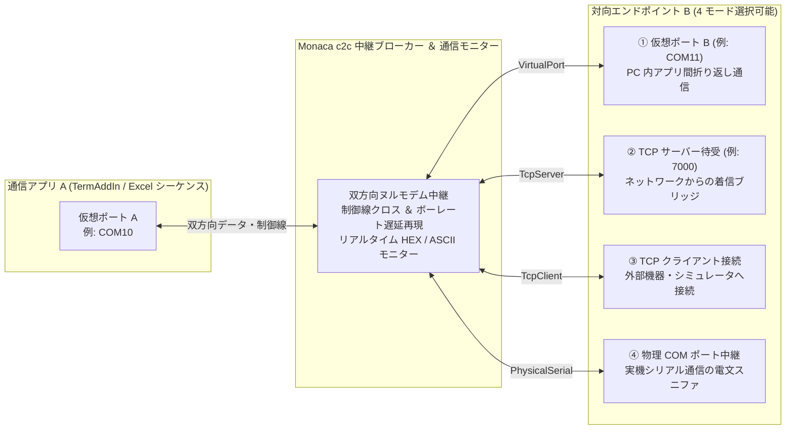



# c2c - ドライバ不要の仮想ヌルモデム・シリアル中継＆通信モニターツール

👉 [← TermAddIn 統合本体に戻る](https://github.com/Monaca-App/TermAddIn)  
👉 [← Monaca アプリ工房（トップ）に戻る](https://github.com/Monaca-App/store)

---

[](https://www.microsoft.com/)
[](https://github.com/Monaca-App/TermAddIn)
[](https://dotnet.microsoft.com/)
[]()
[]()

## 📖 概要

**c2c** は、実機の RS-232C クロスケーブルや USB-シリアル変換器が手元にない環境でも、PC 内部で仮想 COM ポート同士を直結して双方向通信テストを行える **ドライバ不要の仮想ヌルモデム・シリアル中継＆リアルタイム通信モニターツール** です。

従来の仮想シリアルドライバ（`com0com` 等）で課題となっていたカーネルモードドライバのインストール、テスト署名モードへの切り替え、OS 再起動、および管理者権限を一切必要としません。 **c2c** を起動するだけで、Excel 通信制御アドイン **[TermAddIn](https://github.com/Monaca-App/TermAddIn)** （COM シリアル・Modbus RTU/ASCII・MELSEC 計算機リンク）のポート選択リストに仮想ポート（例: `COM10` ⇔ `COM11`）が自動的に現れ、実機と全く同じ操作感で通信シーケンスの開発・デバッグ・自動回帰テストを実行できます。

> [!IMPORTANT]
> ### 💡 本ツール最大の設計思想・特長
> **「カーネルドライバ完全不要・管理者権限ゼロ —— Windows 11 セキュアブート環境や社内制限 PC でも即座に仮想 COM 通信を実現」**
> 
> * **OS 環境を一切汚さないクリーン設計**: 近年の Windows 11 環境（セキュアブート・メモリ整合性 HVCI 有効）や企業の管理 PC では、未署名・旧式のカーネルドライバの導入が厳しく制限されています。本ツールは OS 標準のユーザーモード通信機構のみで動作するため、 **システム設定の変更やドライバ導入を一切行わずに展開直後から安全に稼働** します。
> * **リアルタイム通信モニター標準搭載**: 仮想ポート間を通過するすべての送受信電文を、ミリ秒単位のタイムスタンプとともに **可視 ASCII 表示または 16 進数（HEX）ダンプ** でリアルタイムに監視・ファイル保存できます。



---

## ✨ 主な機能・特徴

### 1. カーネルドライバ完全不要 ＆ 標準ユーザー権限で即時稼働
* デバイスマネージャーへの仮想ドライバ登録や Windows テストモード変更が不要なため、業務用のノート PC や検査ラインの制限アカウント環境でもそのまま起動して利用できます。
* アプリケーションを終了するだけで公開ポート情報が自動的にクリーンアップされ、OS 側に不要な仮想デバイスが残存しません。

### 2. 用途に応じて選べる 4 つの中継（ブリッジ）モード
* 仮想 COM ポート同士をつなぐ **仮想 COM ペアモード** だけでなく、仮想 COM と TCP/IP ソケットを相互変換する **TCP サーバー / クライアントブリッジモード（`com2tcp` 相当）** 、および実機の物理 COM ポートとの間に挟んで通信内容を可視化する **物理シリアル中継（スニファ）モード** を 1 つのツールに統合しています。

### 3. Term / TermAddIn 各通信プロトコルとのシームレス自動連携
* **c2c** で中継を開始すると、稼働中の仮想ポート名が **[TermAddIn](https://github.com/Monaca-App/TermAddIn)** の通信設定画面（[COM シリアル通信](https://github.com/Monaca-App/TermAddIn_Comm)、[Modbus RTU / ASCII](https://github.com/Monaca-App/TermAddIn_Modbus)、[MELSEC 計算機リンク](https://github.com/Monaca-App/TermAddIn_Melco)）のポート選択ドロップダウンに物理 COM ポートと並んで自然順（`COM1`, `COM2`, `COM10`, `COM11`...）で自動表示されます。
* 特別なプラグイン設定や接続先書き換えを行うことなく、本番用の Excel シーケンスシートをそのまま仮想ポートへ向けてテスト実行できます。

### 4. ハードウェア制御線クロス結線 ＆ ボーレート伝送ウェイト再現（EmuBR）
* **制御線クロス結線**: ヌルモデム（クロスケーブル）と同様に、片側の `DTR` 出力を対向側の `DSR` 入力へ、`RTS` 出力を対向側の `CTS` 入力へリアルタイムに交差伝搬します。`RTS/CTS` ハードウェアフロー制御を用いたシーケンスの検証にも対応します。
* **ボーレート遅延再現（EmuBR）**: 有効化すると、設定された通信ボーレート（例: `9600 bps`）と送信データ長から実機相当の伝送所要時間を算出し、ウェイトを再現します。実機接続時に起こりがちな受信分割やタイムアウト境界の事前検証に有効です。

### 5. リアルタイム通信パケットモニター ＆ ログ出力
* ペア間を通過したすべてのパケットについて、「通過時刻（ミリ秒精度）」「転送経路（例: `COM10 -> COM11`）」「バイト数」「データ内容」を画面下部のモニター一覧へリアルタイム表示します。
* チェックボックス 1 つで **可視 ASCII 表示** （制御コード `\r`, `\n`, `<XX>` 可視化付き）と **16 進数（HEX）ダンプ表示** を即座に切り替えられ、任意のタイミングで **CSV 形式またはテキスト形式** へエクスポートできます。

### 6. GUI モードと CLI モード（コマンドライン操作）のハイブリッド対応
* アイコンのダブルクリック（引数なし）で起動すると直感的な **Windows GUI 管理画面** が立ち上がり、コマンドライン引数を付けて起動すると **CLI モード** としてペアの追加・削除・一覧確認・ヘッドレス連続中継・自己診断テストを実行できます。

### 7. 設定変更履歴の自動記録（安心設計・トレーサビリティ）
* 仮想ポートペアの構成を追加・変更して保存した際、変更内容が自動的に監査ログへ記録される安心設計を採用しています。

---

## 🔀 4 つの中継（ブリッジ）モード詳細

ペア追加・編集時に、対向側（エンドポイント B）の動作モードを以下の 4 種類から選択できます。

| モード名称 | 指定値（CLI） | ポート B / 接続先の入力例 | 主な用途・動作イメージ |
| :--- | :---: | :--- | :--- |
| **仮想 COM ペア**<br>*(標準ヌルモデム)* | `VirtualPort`<br>*(既定)* | `COM11`、`CNCB0` | 1 台の PC 内で 2 つの仮想ポート（例: `COM10` と `COM11`）を直結し、Excel シーケンスと疑似応答ツール間で折り返し通信を行います。 |
| **TCP サーバーブリッジ**<br>*(`com2tcp` サーバー相当)* | `--tcp` | `7000`、`127.0.0.1:7000`、`0.0.0.0:7000` | 指定した TCP ポートで外部からのソケット着信を待ち受け、仮想ポート A（例: `COM12`）と双方向変換します。 |
| **TCP クライアントブリッジ**<br>*(`com2tcp` クライアント相当)* | `--tcp-client` | `127.0.0.1:5000`、`192.168.1.50:4001` | 指定した外部 TCP サーバー（Ethernet-シリアル変換器やエミュレータ等）へ自動接続し、仮想ポート A として利用可能にします。 |
| **物理シリアル中継**<br>*(通信モニター・スニファ)* | `--serial` | `COM1`、`COM3:115200` | 仮想ポート A（例: `COM14`）と実機の物理 COM ポート（例: `COM3`）を双方向中継し、実機との送受信電文をモニター画面で可視化します。 |

---

## 🖥️ GUI 画面の構成と操作方法

> [!TIP]
> **📘 GUI 画面イメージ付きの詳細マニュアル**  
> メイン画面の各部名称、ペア設定ダイアログの入力ガイド、HEX 電文モニター・CSV ログ出力例、および TermAddIn 連携手順の画面イメージ付き解説は **[c2c 操作説明書](./Manual/c2c操作説明書.Md)** をご覧ください。

`c2c.exe` を引数なしで起動すると、メイン管理画面が表示され、有効に設定されているすべてのペアの中継が自動的に開始されます。

### 1. ツールバーおよびモニター表示オプション一覧

| ボタン / チェック項目 | 機能説明 |
| :--- | :--- |
| **中継開始 / 中継停止** | 有効（`ON`）になっているすべての仮想ポートペアの中継サーバーを一括で開始・停止するトグルボタンです（稼働中は「中継停止」、停止中は「中継開始」と表示されます）。 |
| **ペア追加** | 新しい仮想ポートペアまたは TCP / 物理 COM ブリッジを追加する設定ダイアログを開きます。 |
| **ペア編集** | 一覧で選択中のペアのポート名・中継モード・オプションを変更します（稼働中は自動再起動して反映）。 |
| **ペア削除** | 一覧で選択中のペアを確認ダイアログ表示後に削除します。 |
| **モニター消去** | 画面下部のリアルタイム通信モニターに表示されているパケット履歴をクリアします。 |
| **ログ出力** | 現在通信モニターに記録されているパケット履歴を CSV ファイル（`.csv`）またはテキストファイル（`.txt`）へ保存します。 |
| **HEX 表示** | 通信モニター上部のチェックボックスです。ON にするとデータ内容を 16 進数バイト列（例: `01 03 00 00 00 0A C5 CD`）で表示し、OFF にすると可視 ASCII 文字列で表示します。 |
| **自動スクロール** | 通信モニター上部のチェックボックスです。ON にすると新しい通信パケットを受信するたびに最新行へ自動スクロールします。 |

### 2. 仮想 COM ペア・ブリッジ一覧（画面上段）
* 各ペアの **ID** 、 **有効状態** 、 **ポート A** 、 **中継モード** 、 **ポート B / 接続先** 、 **オプション（`EmuBR`, `DTR/RTS`）** 、 **現在の状態（`停止` / `待受中` / `通信中` / `無効`）** 、および **累計転送バイト数（`A->B / B->A`）** がリアルタイムに表示されます。
* 行をダブルクリックすると、そのペアの編集ダイアログを素早く開くことができます。

### 3. リアルタイム通信モニター（画面下段）
* 中継を通過した電文が最大 2,000 パケットまでリングバッファ形式で高速描画されます。
* Modbus RTU や MELSEC バイナリフレームのデバッグ時は **「HEX 表示」** にチェックを入れ、SCPI や汎用テキストコマンドの対話確認時はチェックを外すことで、プロトコルに応じた最適な視認性が得られます。

---

## ⌨️ コマンドライン（CLI）モードの使い方

自動テストスクリプトやバッチファイルから仮想ポートの構成管理・ヘッドレス稼働を行いたい場合は、`c2c.exe` にサブコマンドを指定して実行します。

### サブコマンド一覧

| コマンド構文 | 役割・動作内容 |
| :--- | :--- |
| `c2c list` | 登録済みの仮想ポートペア一覧と、現在稼働・公開中の仮想ポート名を表示します。 |
| `c2c add <PortA> <PortB> [--emubr]` | 仮想 COM ペア（`PortA` ⇔ `PortB`）を新規追加します。`--emubr` 指定でボーレート遅延再現を有効化します。 |
| `c2c add <PortA> --tcp <Port\|Host:Port>` | 仮想 COM ポートと TCP サーバー待受ポートのブリッジを追加します。 |
| `c2c add <PortA> --tcp-client <Host:Port>` | 仮想 COM ポートから指定 TCP ホストへ接続するクライアントブリッジを追加します。 |
| `c2c add <PortA> --serial <COMx[:Baud]>` | 仮想 COM ポートと物理シリアルポートの中継ブリッジを追加します。 |
| `c2c remove <PairId\|PortName>` | 指定したペア ID またはポート名に該当するペア設定を削除します。 |
| `c2c enable <PairId\|PortName>` | 指定したペアを有効化します。 |
| `c2c disable <PairId\|PortName>` | 指定したペアを無効化します。 |
| `c2c run` | GUI を表示せずコンソール上で中継サーバーを連続稼働し、通過パケットを標準出力へリアルタイム表示します（`Ctrl+C` で停止）。 |
| `c2c test` | 仮想ポート登録・双方向通信・制御線クロス結線の自己診断テストを実行し、合否を終了コード（`0`: 正常、`1`: 異常）で返します。 |
| `c2c --help` | コマンドラインの使用方法とサブコマンド一覧を表示します。 |

### CLI 実行例（PowerShell / コマンドプロンプト）

```powershell
# 1. 仮想 COM ペア (COM10 <-> COM11) をボーレート遅延再現付きで追加
c2c.exe add COM10 COM11 --emubr

# 2. 仮想 COM12 と TCP ポート 7000 のサーバーブリッジを追加
c2c.exe add COM12 --tcp 7000

# 3. 登録済みペアと稼働状態を確認
c2c.exe list

# 4. 自己診断テストを実行（導入環境の動作確認）
c2c.exe test

# 5. ヘッドレスモードで中継サーバーを起動（Ctrl+C で終了）
c2c.exe run
```

---

## 💻 動作環境・システム要件

| 項目 | システム要件 |
| :--- | :--- |
| **OS** | Windows 10 / Windows 11 (64bit / 32bit) |
| **ランタイム** | .NET Framework 4.8（Windows 10 / 11 標準搭載） |
| **必要権限** | **標準ユーザー権限で動作** （管理者権限不要、カーネルドライバ署名変更・OS 再起動不要） |
| **対応連携ソフト** | ・ **[TermAddIn](https://github.com/Monaca-App/TermAddIn)** （Excel 32bit 版 / 64bit 版 双方対応：`Comm` / `Modbus` RTU・ASCII / `Melco` 計算機リンク）<br>・ **Term** スタンドアロン通信アプリケーション<br>・TCP ブリッジモード経由であらゆる外部ソケット通信ツール・シミュレータと連携可能 |
| **ディスプレイ** | 推奨解像度: **Full HD (1920 × 1080) 以上** （最小動作解像度: 1024 × 768） |

---

## 🚀 セットアップ・起動手順

1. 配布アーカイブを任意のフォルダへ展開（解凍）します（インストーラーによるレジストリ変更やドライバ組み込みは不要です）。
2. フォルダ内の **`c2c.exe`** をダブルクリックして起動します。
3. 初回起動時には既定の仮想ポートペア **`COM10` ⇔ `COM11`** が自動生成され、直ちに **「待受中」** 状態で中継が開始されます。

### ⚠️ 初回起動時にセキュリティ確認が表示される場合
* **Microsoft Defender SmartScreen（「Windows によって PC が保護されました」）が表示された場合**:
  1. 画面内の **「詳細情報」** をクリックします。
  2. 右下に表示される **「実行」** ボタンをクリックすると起動します。
* **ダウンロードした ZIP アーカイブがブロックされている場合**:
  1. 展開前にアーカイブファイルを右クリックし、 **「プロパティ」** を開きます。
  2. 「全般」タブ下部の **「許可する」** にチェックを入れて **「OK」** を押し、その後展開してください。

### アンインストール手順
* 稼働中の `c2c.exe` を終了した上で、展開したプログラムフォルダを削除してください。ペア設定ファイルも消去したい場合は、`%LOCALAPPDATA%\Monaca\c2c` フォルダを削除することで完全に初期状態へ戻ります。

---

## 🔰 クイックスタート（TermAddIn で実機なし折り返し通信を試す手順）

実機ハードウェアを一切接続せずに、1 台の PC 上で **[TermAddIn](https://github.com/Monaca-App/TermAddIn)** のシリアル通信シーケンスをテストする基本手順です。

### ステップ 1: c2c を起動して仮想ペアを公開する
1. **`c2c.exe`** を起動します。
2. 上段の一覧に **`COM10` ⇔ `COM11`** が表示され、状態列が **「待受中」** になっていることを確認します（別のポート番号を使いたい場合は「ペア編集」または「ペア追加」で自由に変更できます）。

### ステップ 2: TermAddIn（または Term）側で仮想ポートを選択する
1. Excel を開き、リボンの **「ツール起動 (`ToolOpen`)」** からメイン画面および **「プロパティ」** 設定画面を開きます。
2. **「シリアル通信 (COMポート)」タブ** （または Modbus RTU / MELSEC 計算機リンク設定タブ）を開くと、ポート名のドロップダウンリストに **`COM10`** と **`COM11`** が自動的に追加されています。
3. テスト対象のシーケンス側で **`COM10`** を選択して確定します。

### ステップ 3: 対向側シミュレータを接続して通信を実行する
1. もう 1 つの Term 画面（または応答シミュレータ、TCP ブリッジ接続ツール等）で対向ポート **`COM11`** をオープンします。
2. Excel シート上のシーケンス行で **[ 実行 ]** ボタン（または **Start** ボタン）をクリックすると、`COM10` から送信されたコマンド電文が即座に `COM11` 側へ届き、`COM11` からの応答が Excel の **Result（結果セル）** に自動記録されます。

### ステップ 4: 通信モニターで電文を確認・保存する
1. **c2c** のメイン画面下部にある **「リアルタイム通信モニター」** に、`COM10 -> COM11` および `COM11 -> COM10` の全送受信データが時刻付きで表示されます。
2. バイナリ電文（Modbus RTU 等）を確認したい場合は **「HEX 表示」** を ON に切り替え、必要に応じて **「ログ出力」** ボタンから CSV ファイルとしてエビデンス保存します。

---

## ⚙️ 設定ファイルと稼働ポート管理ファイル

**c2c** のペア設定および稼働状態は、ユーザーごとのローカルアプリケーションデータフォルダ配下で安全に管理されます。

* **ペア構成設定ファイル**: `%LOCALAPPDATA%\Monaca\c2c\c2c_pairs.xml`（`<LOCALAPPDATA>\Monaca\c2c\c2c_pairs.xml`）
  * 登録した各ペアのポート名、中継モード、有効/無効フラグ、ボーレート遅延再現（EmuBR）、制御線クロス設定が XML 形式で自動保存され、次回起動時にもそのまま復元されます。
* **稼働ポート公開ファイル**: `%LOCALAPPDATA%\Monaca\c2c\active_ports.txt`
  * **c2c** が中継稼働中の間のみ公開ポート一覧を記録し、Term / TermAddIn 側からの自動ポート検出に使用されます。中継停止時または **c2c** 終了時に自動削除されます（万一プロセスが強制終了した場合でも、生存確認機構により無効な古いポート情報は自動的に除外されます）。
* **監査・エラーログ**: `%USERPROFILE%\Desktop\Monaca\info.log`（既定パス）
  * ペア構成の変更保存履歴や異常発生時の診断ログが記録されます。

---

## 📄 ライセンス & サポート

> [!NOTE]
> **無償提供ユーティリティのご案内**  
> **c2c** は、Monaca アプリ工房の各通信製品（Term / TermAddIn 等）における事前検証・シーケンス開発・デバッグ・自動テストを支援する **無償の公式コンパニオンユーティリティ** です。個別のライセンスファイル配置や評価期間の制限なく、すべての機能を無期限でご利用いただけます。

* **開発元**: [Monaca アプリ工房 (Monaca App Store)](https://github.com/Monaca-App/store)
* **連携製品**: [TermAddIn](https://github.com/Monaca-App/TermAddIn)（[Comm](https://github.com/Monaca-App/TermAddIn_Comm) / [Modbus](https://github.com/Monaca-App/TermAddIn_Modbus) / [Melco](https://github.com/Monaca-App/TermAddIn_Melco)）
* **Copyright**: Copyright (C) Monaca App Store 2026 All rights reserved.
* **お問い合わせ**: 不具合報告や機能要望は、GitHub の Issue までお気軽にお寄せください。
